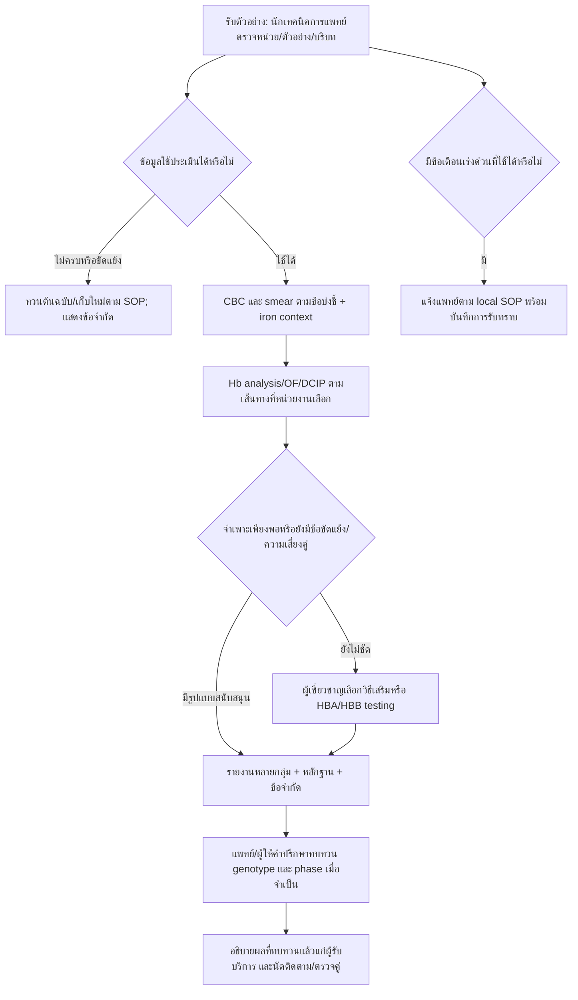

# ชุดทบทวนกฎโดยผู้เชี่ยวชาญและ UAT — ThalLink

เตรียมวันที่ **15 ตุลาคม 2026** · สถานะ **รอผู้เชี่ยวชาญและผู้ใช้จริงทดสอบ** · ข้อมูลทั้งหมดเป็นข้อมูลสมมติ

เอกสารนี้เป็นชุดงานสำหรับ hematologist, นักเทคนิคการแพทย์, ผู้รับผิดชอบคุณภาพ และผู้พัฒนา ไม่ใช่ผลการทบทวนจากแพทย์จริง ไม่มีการลงนามแทนผู้ทบทวน ไม่มีการเปลี่ยนค่าตัดทางคลินิกเพื่อจัดทำเอกสารนี้ และไม่ถือว่าการผ่าน automated tests เท่ากับผ่าน clinical validation รุ่นปัจจุบันยังจำกัดการเรียนรู้/ทบทวนภายในเครื่อง

## 1. ขอบเขตและวิธีอ่านบัญชีกฎ

เปิด [RULE_INVENTORY.csv](RULE_INVENTORY.csv) ด้วย UTF-8/Excel แล้วกรอง `module` และ `entry_kind` ตารางมี rule ID, เหตุผล/ข้อความเดิม, predicate/operator, เกณฑ์เดิม, แหล่งอ้างอิง, output, ตำแหน่งโค้ดและ SHA-256 รวม CBC, screening, PCR/พันธุกรรม และหกกลุ่มงานเพิ่มเติม

| ชนิดรายการ | วิธีใช้ในการทบทวน |
|---|---|
| `declared_rule` | กฎ screening แต่ละ ID พร้อมเงื่อนไข all/any/none, priority และข้อความเหตุผลเดิม |
| `emitted_rule` | ID ที่ engine อาจส่งออก; ขยาย ID ที่ประกอบจากชื่อ field/direction ให้เป็นรายการที่อ่านได้ อาจมี ID เดียวหลายตำแหน่ง |
| `clinical_group` | การจัดกลุ่มจาก rule IDs เดิม เป็นข้อเสนอ workflow เพิ่มเติม ไม่มีค่าตัดใหม่ |
| `demonstration_target` | เป้าหมาย PCR ทั้งหมดพร้อม expected bp; ทุกขนาดยังเป็นสาธิต ต้องอ้าง primer/assay SOP จริง |
| `configuration` | ค่า threshold, score, age table และขอบเขต input ปัจจุบันทั้งหมด; input bounds ไม่ใช่ช่วงอ้างอิงปกติ |
| `decision` / `predicate_formula` | กิ่งเงื่อนไขรวม validation, fallback, controls และตัวแปรคำนวณจากโค้ด เพื่อไม่ให้กฎที่ไม่มี runtime ID หายไป |
| `output_template` | ข้อความเดิมทุก template; ข้อความมี placeholders ที่ต้องตรวจพร้อมตัวอย่างจริง |
| `source_reference` | แหล่งอ้างอิงเดิมของแต่ละโมดูล แถวอื่นอ้าง `SOURCE:<module>` มาที่แถวนี้ |

`DECISION:*`, `FORMULA:*`, `TEXT:*` และ `GROUP:*` เป็นรหัสบัญชีทบทวน ไม่ใช่รหัสวินิจฉัยหรือ runtime rule IDs เดิม รายการ `decision` แสดง predicate ณ จุดนั้น ไม่ใช่การพิสูจน์ทุกเส้นทางในโปรแกรม; ให้ใช้ร่วมกับ source, สูตรที่เกี่ยวข้องและผลทดสอบ ทุกแถวคง `REVIEW_REQUIRED` และบอกตรง ๆ ว่ายังไม่ทำ mapping ของทุกกฎไปยังหน้า/หัวข้อ guideline ความครบของ inventory ไม่ใช่หลักฐานว่าทุกกฎมีหลักฐานคลินิกเพียงพอ

สร้าง/ตรวจหลังแก้โค้ดหรือ JSON:

```powershell
.venv\Scripts\python.exe -X utf8 scripts/generate_rule_inventory.py
.venv\Scripts\python.exe -X utf8 scripts/generate_rule_inventory.py --check
.venv\Scripts\python.exe -X utf8 -m unittest discover -s tests -p test_rule_inventory.py -v
```

Generator อ่านไฟล์แต่ละไฟล์ครั้งเดียวและไม่ import/execute engines ไม่เปลี่ยนกฎหรือเพิ่มวันที่ปัจจุบันลง CSV การแก้ input file แม้ไม่มีการเพิ่ม rule ID ทำให้ hash เปลี่ยนและ `--check` ล้มเหลว ต้องตรวจ diff แล้วสร้าง inventory ใหม่

## 2. หลักฐานที่เปิดอ่านและข้อจำกัดการอ้างอิง

วันที่เข้าถึงแหล่งออนไลน์: 15 ตุลาคม 2026 แหล่งด้านล่างประกอบการออกแบบ workflow ไม่ได้แสดงว่าหน่วยงานเหล่านี้รับรอง ThalLink

| Ref | แหล่ง/ตำแหน่ง | ข้อใช้และงานที่ยังค้าง |
|---|---|---|
| S01 | [กรมวิทยาศาสตร์การแพทย์: คลังเอกสาร](https://nih.dmsc.moph.go.th/th/downloadBook/km?gid=27&keyword=&page=2&selectFilter=&sort=1), รายการ “แนวทางปฏิบัติในการตรวจทางห้องปฏิบัติการเพื่อสนับสนุนการควบคุมและป้องกันโรคธาลัสซีเมีย ฉบับปรับปรุง 2562” | ยืนยันว่ามีรายการเอกสารทางการ; ตัวอ่านเว็บดึงไฟล์ฉบับเต็มไม่ได้เพราะเกินขนาดที่รองรับ จึง **ยังไม่ตรวจเนื้อหา/เลขหน้าและไม่อ้างรับรองค่าตัดจากฉบับนี้** ผู้รับผิดชอบต้องเลือกฉบับไทย/SOP ที่ใช้อยู่จริงและใส่เลขหน้า |
| S02 | [ARUP Consult: Thalassemias](https://arupconsult.com/content/thalassemias), Initial Evaluation, Hemoglobin Assays, Genetic Testing; update April 2026 | เริ่มจาก CBC/smear และ iron studies, ยืนยัน Hb ด้วยวิธีเสริมและเลือก molecular testing ตามข้อบ่งชี้; iron deficiency/การรับเลือดรบกวนการแปลผลได้ ไม่ใช้ Hb pattern เดี่ยวเป็น genotype |
| S03 | [TIF Prevention, Vol. 2](https://www.thalassaemia.org.cy/wp-content/uploads/2017/08/PreventionVol2_English.pdf), §1.1.1–1.1.5 หน้าเอกสาร 2–5 (PDF หน้า 14–17), §1.2.1 | ต้องกำหนด reference ตามวิธีและประชากร; microcytosis ที่ HbA2 ไม่สูงยังมีหลายสาเหตุ รวม iron deficiency, alpha และบาง beta variants ข้อแตกต่างระหว่างคำว่า `>` กับ `>=` และค่าที่ใช้ในแอปต้องเข้าวาระทบทวน ไม่เปลี่ยนอัตโนมัติ |
| S04 | [WHO haemoglobin guideline 2024](https://www.who.int/publications-detail-redirect/9789240088542), [Executive summary, Tables 2–3](https://www.ncbi.nlm.nih.gov/books/NBK602183/?report=reader) | เกณฑ์ Hb/ระดับความรุนแรงขึ้นกับประชากรและการตั้งครรภ์ ขอบเขต CBC ของแอปแคบกว่าทั้ง guideline; เกณฑ์ anemia ไม่ใช่เกณฑ์สั่งให้เลือด |
| S05 | [GeneReviews: Alpha-Thalassemia](https://www.ncbi.nlm.nih.gov/sites/books/NBK1435/), Diagnosis/testing และ Genetic counseling; update 23 April 2026 | ยืนยัน molecular findings และ phase/จีโนไทป์ของพ่อแม่ก่อนนำความเสี่ยงทางพันธุกรรมไปให้คำปรึกษา ผล band สาธิตไม่ยืนยัน genotype |

แหล่งเดิมของอีกหกกลุ่มงานอยู่ใน [WBC/Marrow](SOURCES_WHITE_MARROW.md), [Hemostasis/VTE](SOURCES_HEMOSTASIS.md), [Transfusion/Morphology](SOURCES_TRANSFUSION_MORPHOLOGY.md) และแถว `source_reference` ของ inventory ครั้งนี้คงแหล่งเดิมไว้ ไม่อ้างว่าทบทวนเนื้อหาใหม่ครบทุกแหล่ง

### ตารางทบทวน screening หลักสำหรับผู้เชี่ยวชาญ

ค่าด้านล่างคือ **ค่าเริ่มต้นปัจจุบัน** ของ `clinical_rules.json` และ operators ใน engine ไม่ได้ปรับให้ตรง guideline ใหม่ การประเมินจริงต้องอ่าน `thresholds_used` โดยเฉพาะเมื่อปรับเกณฑ์ในหน้าจอ ทุกแถว **รอทบทวน**; แหล่ง S02/S03/S05 เป็นหลักประกอบแนวคิด ยังไม่ใช่ mapping ที่รับรองทุก cutoff/ขอบเขต

| Rule ID | เหตุผลที่แสดงผล | เงื่อนไข/เกณฑ์เดิม | Output/ขั้นต่อไป | Source mapping ที่ต้องทบทวน |
|---|---|---|---|---|
| `pediatric_review` | Hb fractions เปลี่ยนตามวัย | ทราบอายุ และอายุ `<1 ปี` | ระงับข้อสรุป phenotype/genotype แบบผู้ใหญ่ ส่งทบทวนเด็ก | S02 บริบทการตรวจ; cutoff 1 ปีและขอบเขตยังต้องมีแหล่งเฉพาะ |
| `alpha_variant` | มีหลักฐานที่อาจสัมพันธ์กับ alpha variants | HbH inclusion=Positive หรือ HbH/Bart/CS ที่รายงาน `>0%` | สงสัย alpha/HbH/CS; ทบทวน smear/Hb analysis และ HBA1/HBA2 ตามข้อบ่งชี้ | S05 Diagnosis/testing; ความเหมาะสมของ `>0`/วิธีวัดต้องยืนยัน |
| `hbe_pattern` | ผล HbE หรือ screening DCIP สนับสนุนให้ตรวจยืนยัน | HbE ที่แยกวัด `>0%` หรือ DCIP=Positive; **ไม่ใช่** cutoff HbE 10% ของสัญญาณคะแนนอีกตัว | สงสัย HbE/variant ไม่ระบุ zygosity; ยืนยันชนิด Hb | S03 §1.1.2; assay-specific detection และ specificity ต้องทบทวน |
| `combined_peak` | พีครวมยังแยก HbA2/HbE ไม่ได้ | มีค่ารวม HbA2/E ที่เป็น finite number และไม่มีสัญญาณ HbE/DCIP/HbA2 สูงตามกฎ | indeterminate; ทบทวน chromatogram/วิธีที่แยกพีคได้ | S03 §1.1.2–1.1.3; รวม 0 ก็เป็นค่าที่รายงาน ต้องทบทวน wording |
| `beta_trait` | HbA2 แยกวัดสูงสนับสนุนข้อสงสัย | ทราบอายุ `>=1 ปี`, `3.5<=HbA2<=10%`, ไม่มี HbE/DCIP positive/ประวัติรับเลือด true | สงสัย beta trait; iron/method review, HBB/ตรวจคู่ตามข้อบ่งชี้ | S02/S03 §1.1.3; operator equality, upper 10%, อายุ และ missing transfusion เป็นประเด็นทบทวน; grouping เพิ่ม uncertainty เมื่อ context ขาด |
| `high_fraction_review` | สัดส่วนสูงผิดแบบต้องตรวจวิธี/variants | ทราบอายุ `>=1 ปี` และ (`HbA2>10%` หรือ `HbF>5%`) | indeterminate/specialist review; ไม่แยก HPFH หรือ beta genotype อัตโนมัติ | S03 §1.1.3–1.1.5; ค่าและ population applicability ยังไม่ลงนาม |
| `iron_deficiency` | Ferritin ต่ำสนับสนุน iron deficiency แต่ไม่ตัดภาวะร่วม | Ferritin `<15 ng/mL` | iron/mixed; ประเมิน iron/inflammation และทบทวน HbA2 ตามแผนแพทย์ | S02 iron context; cutoff 15 ต้องระบุแหล่ง/ประชากรเฉพาะ |
| `micro_unresolved` | Micro/hypochromia ยังมีหลายสาเหตุ | MCV/MCH ต่ำกว่า age-dependent limits (ผู้ใหญ่ `<80 fL` / `<26 pg`); ไม่มีสัญญาณ HbA2 สูง, HbE/DCIP, alpha/HbH หรือ ferritin ต่ำ | indeterminate; iron review/Hb analysis/HBA ตามบริบท ไม่ยืนยัน alpha จาก CBC | S03 §1.1.5; ทุก age limit และ MCH26 ต้อง mapping เพิ่ม; ไม่มีสัญญาณไม่เท่ากับผลลบยืนยัน |
| `of_screen` | OF/NESTROFT เป็น screening | OF/NESTROFT=Positive | ทบทวน CBC/Hb analysis/iron และยืนยันตามข้อบ่งชี้ | ต้องเทียบ S01/SOP ฉบับที่หน่วยงานเลือก; ผลบวกไม่ระบุชนิดพาหะ |

ทุกกฎข้างต้นถูกระงับการจัดกลุ่มโรคเมื่อ input invalid; valid urgent Hb observation แยกคงอยู่ กฎที่ match พร้อมกันยังอยู่ใน evidence และกลุ่มผลเพิ่ม ไม่ถือ priority สูงสุดเป็นสาเหตุเดียว

## 3. คำถามที่ต้องให้ผู้เชี่ยวชาญตัดสิน

| ID / ความสำคัญ | คำถาม/หลักฐานที่ต้องนำมา | สิ่งส่งมอบจากผู้ทบทวน |
|---|---|---|
| ER01 / สูง | ใช้เพื่อ teaching, screening, ANC หรือ hospital lab; ใช้ guideline ไทย/SOP ฉบับใด เครื่องใด ประชากรใด? | ระบุขอบเขต อายุ การตั้งครรภ์ วิธีวัด และหน้าของ guideline ที่ใช้จริง |
| ER02 / สูง | Screening ใช้ MCV ผู้ใหญ่ `<80 fL`, MCH `<26 pg`, HbA2 แยกวัด `>=3.5%`; TIF §1.1 มีตัวอย่าง/ตัวดำเนินการต่างกัน ขอบก้ำกึ่งตาม assay ควรจัดอย่างไร? | บันทึกข้อเสนอคง/เปลี่ยน พร้อมเหตุผล uncertainty ของ assay และ cases ต่ำกว่า/เท่ากับ/สูงกว่า; ยังไม่แก้ค่าจนทบทวน |
| ER03 / สูง | ตารางอายุ Hb/Hct/MCV/MCH เดิมทุกช่วงมีที่มารองรับหรือไม่? Screening เกณฑ์ตั้งครรภ์เดิมไม่ได้แบ่ง trimester; CBC จำกัดผู้ใหญ่ไม่ตั้งครรภ์ 18–65 ปี | mapping รายเกณฑ์ไปยังฉบับ/หน้า และช่องว่างที่ต้องระงับการใช้นอก scope |
| ER04 / สูง | Hb alert screening `<7 g/dL` กับ CBC `<8 g/dL` มีวัตถุประสงค์ต่างกันอย่างไร? ข้อความระดับเร่งด่วนควรอ้าง critical-value SOP ของใคร? | แยก definition, ผู้รับแจ้ง, วิธี read-back และเวลาตอบสนอง; ห้ามรวมเกณฑ์เป็นค่าเดียวโดยพลการ |
| ER05 / สูง | HbA2/HbE แยกวัด/พีครวม, HbF สูง, HbH/CS/Bart, HbA2 ก้ำกึ่ง, รับเลือดล่าสุด/iron deficiency มีเส้นทางยืนยันอะไร? | วิธีตรวจเสริม, interference ที่ต้องถาม, เงื่อนไขส่ง HBA/HBB และข้อจำกัด ไม่ใช้พีครวมแทน HbA2 [S02–S03] |
| ER06 / สูง | Ferritin เดิม `<15` และช่วง `15–<30 ng/mL` เหมาะกับประชากร/การอักเสบหรือไม่? ขาดเหล็กร่วม thal จะรายงานอย่างไร? | ระบุหลักฐานราย cutoffs; คงหลายข้อค้นพบ ไม่ใช้ ferritin ไม่ต่ำตัด iron deficiency |
| ER07 / กลาง | Mentzer/RBC/RDW/คะแนน 0–100 มี utility เท่าใด? กลุ่ม `High/Moderate` ทำให้เข้าใจเป็นความน่าจะเป็นหรือความรุนแรงหรือไม่? | ตัดสิน wording/การแสดงคะแนนแยกจาก diagnosis พร้อมผล comprehension UAT |
| ER08 / สูง | PCR: รายการ target, primer, expected bp, tolerance, controls และ variant นอก panel ครบตาม assay จริงหรือไม่? | ฉบับ assay/SOP และ verification dataset; ค่า bp ในแอปยังเป็นสาธิต ไม่มีการลงนามผล |
| ER09 / สูง | การตรวจคู่และ DNA ต้องทราบ allele/phase ใดก่อนคำนวณความเสี่ยง? ใครเป็นผู้ให้ genetic counseling? | approved workflow ของหน่วยงานและถ้อยคำที่ไม่ตีตราผู้รับบริการ [S05] |
| ER10 / สูง | WBC adult ANC/ไข้, marrow blast/APL, local platelet critical limit, D-dimer หน่วย/assay/pathway, transfusion gates และ morphology limits ใช้ได้กับประชากรใด? | ผู้ทบทวนแต่ละสาขาใส่ mapping และ independent expected cases ของโมดูลตนเอง; ไม่ลงนามเหมารวมจาก screening |

ใช้ [RULE_REVIEW_TEMPLATE.md](RULE_REVIEW_TEMPLATE.md) บันทึก **ทีละ rule ID/ชุดกฎที่มีเหตุผลเดียวกัน**: current expression → proposed expression → source edition/page → expected cases ที่ผู้เชี่ยวชาญกำหนดก่อนดูผลแอป → discrepancy → disposition ชื่อและลายเซ็นต้องเป็นของผู้ทบทวนจริงเท่านั้น

## 4. กลุ่มผลและเส้นทางงานที่เสนอ

ตารางนี้เป็นนโยบายการแสดงผลเพิ่มจากกฎเดิมใน `logic/clinical_grouping.py` ไม่เพิ่มค่าตัด ไม่เปลี่ยน top pattern เดิม และให้หลายกลุ่มปรากฏพร้อมกันเมื่อมีหลักฐานร่วม `indeterminate` เป็น overlay เมื่อข้อมูล/วิธีตรวจ/บริบทไม่ครบ ทุกกลุ่มเป็นร่างที่ต้องทบทวน [S02–S03]

รายการ `required_numbers` และการรอ OF/DCIP ครบก่อนแสดง `no_specific_pattern` เป็น **นโยบายการแสดงผลอย่างระมัดระวังของแอปที่ยังรอผู้เชี่ยวชาญทบทวน** ไม่ใช่คำแนะนำจาก guideline ให้สั่งทุกการตรวจแก่ทุกคน กลุ่มสงสัยที่มีกฎเดิมสนับสนุนยังแสดงได้พร้อม `indeterminate` เมื่อบริบทอื่นขาด และไม่ได้อ้างว่ากลุ่มนั้นยืนยันแล้ว

| กลุ่ม | หลักฐานจากกฎเดิม | ผู้รับผิดชอบ/ขั้นถัดไป | ใจความสำหรับผู้รับบริการหลังผู้ประกอบวิชาชีพทบทวน |
|---|---|---|---|
| ข้อมูลไม่ผ่าน validation | ข้อมูลผิด ไม่จำกัดค่า หน่วย/ช่วงไม่รองรับ | นักเทคนิคการแพทย์ตรวจต้นฉบับและแก้ก่อนประเมินใหม่; ข้อเตือนที่ประเมินได้ยังอยู่ | ต้องตรวจข้อมูลเพิ่มเติมก่อนอธิบายผล |
| สงสัย alpha/HbH/CS | `alpha_variant` | นักเทคนิคการแพทย์+แพทย์ทบทวน smear/Hb analysis และ HBA1/HBA2 ตามข้อบ่งชี้ | ผลบางส่วนควรตรวจยืนยัน ยังไม่ระบุจีโนไทป์ |
| สงสัย beta-thal trait | `beta_trait` | ยืนยัน HbA2 แยกวัด ทบทวน iron/วิธีตรวจ; HBB/ตรวจคู่ตาม SOP | ยังเป็นผลคัดกรอง ไม่ยืนยันพาหะหรือความเสี่ยงบุตร |
| สงสัย HbE/variant | `hbe_pattern` | ยืนยันชนิด Hb ด้วยวิธีที่เหมาะสม; DNA เมื่อจำเป็น | ยังระบุชนิด/จำนวน allele ไม่ได้ |
| Iron deficiency/อาจมีภาวะร่วม | `iron_deficiency`; ไม่ลบกลุ่ม thal ที่พบร่วม | แพทย์ประเมิน iron status/การอักเสบและวางแผนติดตามร่วมกับแล็บ | อาจมีมากกว่าหนึ่งสาเหตุ ต้องให้ผู้ดูแลประเมิน |
| ยังสรุปไม่ได้ | `combined_peak`, `high_fraction_review`, `micro_unresolved`, `of_screen`, `pediatric_review` หรือ context ไม่ครบ | เติมบริบท/ผลตรวจ เลือก Hb typing/DNA ตามข้อบ่งชี้ ไม่ติดป้าย alpha จาก microcytosis อย่างเดียว | ต้องเติมข้อมูลหรือตรวจเพิ่มเติม |
| ยังไม่พบรูปแบบจำเพาะจากข้อมูลชุดนี้ | ไม่มี matched rule และข้อมูลที่นโยบายต้องใช้ครบ; ไม่มี CBC flag ที่ยังอธิบายไม่ได้ | แพทย์ทบทวน family/partner risk และ scope | **ไม่ใช่ข้อความว่าไม่เป็นพาหะ** และไม่ตัด silent/out-of-panel variants |

ข้อเตือน Hb ต่ำเร่งด่วนแยกจากกลุ่มสาเหตุเสมอ ขั้นตอนและเวลาตอบสนองเป็นไปตาม critical-value SOP ของหน่วยงาน ไม่รอ Hb typing หรือ DNA และแอปไม่สั่งการรักษา



ขั้นตอนทั้งหมดเป็นข้อเสนอเพื่อให้หน่วยงานปรับ ไม่ใช่ reflex order ที่แอปสั่งอัตโนมัติ คู่เสี่ยง/หญิงตั้งครรภ์ต้องจัดการเวลาและการส่งต่อโดยทีมที่รับผิดชอบ ไม่รอขั้นตอนซ้ำที่ไม่จำเป็น การตรวจซ้ำและ molecular testing เลือกตามคำถามทางคลินิกและข้อจำกัดวิธี [S02, S05]

รายงานสำหรับ **บุคลากร** ควรมี input/unit/method, เวลาและที่มาผล, local reference, matched IDs, หลายกลุ่มที่พบ, missing/conflicting evidence, next action/owner, รุ่นและ hash กฎ และสถานะ draft ส่วนข้อความสำหรับ **ผู้รับบริการ** ใช้ภาษาธรรมดา อธิบายสิ่งที่ยังไม่ทราบ/ขั้นต่อไป ไม่ส่งคะแนน/จีโนไทป์สมมติเป็นผลยืนยัน ผู้ประกอบวิชาชีพต้องทบทวนก่อนสื่อสาร; แอปไม่ได้ส่งรายงานแก่ผู้ป่วยอัตโนมัติ

## 5. หน่วยและข้อมูลที่ใช้ทดสอบ

หน่วยต่อไปนี้มาจาก schema ของโปรแกรม ไม่ใช่ข้อเสนอเปลี่ยนหน่วยหรือ reference interval:

| ข้อมูล | หน่วยที่ช่องรับข้อมูลกำหนด | สิ่งที่ต้องตรวจ |
|---|---|---|
| Hb/Hct | g/dL / % | Hb ที่รายงานเป็น g/L ต้องแปลงโดยกระบวนการที่ตรวจสอบแล้วก่อนกรอก; แอปไม่เดาหน่วย |
| RBC / WBC / platelet / absolute retic | 10¹²/L / 10⁹/L / 10⁹/L / 10⁹/L | ห้ามนำ percentage retic ไปใส่ absolute retic หรือใช้ WBC raw cells/µL แทน 10⁹/L โดยตรง |
| MCV / MCH / ferritin | fL / pg / ng/mL | ขอบเขตตัวเลขตรวจข้อมูลไม่ใช่เกณฑ์โรค; หน่วยจากไฟล์ต้นทางต้องตรง |
| Hb fractions / differential | % | HbA2 แยกวัดกับ HbA2/E รวมเป็นคนละ measurand; missing ≠ 0 |
| PT/aPTT / fibrinogen | s / g/L | PT/ULN และ aPTT/ULN ไม่ใช่ INR |
| D-dimer | หน่วยและ FEU/DDU ตามทั้ง value และ cutoff | ต้องตรงกันและมี assay/pathway confirmation; ไม่แปลง FEU/DDU โดยอัตโนมัติ |
| PCR / อุณหภูมิ / specimen age | bp / °C / h | PCR bp ต้องอ้าง assay จริง; อายุสิ่งส่งตรวจเทียบ local stability limit ที่ยืนยันแล้ว |

## 6. UAT ทางคลินิกและการส่งต่อข้อมูล

ให้ผู้ทบทวนระบุ expected result เพิ่มเติม **ก่อนดูผลโปรแกรม** ผู้ปฏิบัติหนึ่งคนและผู้สังเกตหนึ่งคน ใช้ source/lock/rules snapshot เดียวกัน บันทึก Windows, browser, viewport, theme และ SHA-256 เก็บเฉพาะข้อมูลสมมติ ประมาณ 60–90 นาทีต่อรอบแบ่งตามสาขาได้

Baseline screening **SYN-A**: อายุ 30 ปี, sex=Male, pregnant=False, Hb=13.5, MCV=85, MCH=28, RBC=4.8, ferritin=60, HbA2 แยกวัด=2.5%, HbF=0.5%, HbE=0%, HbH/Bart/CS=0%, Hb method=CZE, OF/DCIP/HbH inclusion=Negative, transfusion_recent=False, family_history=False; เว้น HbA และพีครวมไว้เมื่อตัวอย่างไม่ได้ให้ ค่าอื่นที่โจทย์ไม่กำหนดให้คง baseline หรือ unknown ตาม schema ไม่เดาผลลบให้ผู้ป่วยจริง

| ID | สถานการณ์สมมติ/ขั้นตอน | Acceptance criteria |
|---|---|---|
| CU01 | SYN-A จากแบบฟอร์มและ CSV | normalized values, groups, flags และกฎตรงกัน (เวลา/รหัสแถวอาจต่าง); ไม่มีคำยืนยันว่าไม่เป็นพาหะ |
| CU02 | SYN-A: MCV=79.9, MCH=26.9 แล้วแยกลอง MCV=80 และ MCH=26/25.9 | 79.9 เป็น micro ตามกฎเดิม; 26.9 **ไม่** ต่ำกว่า MCH cutoff เดิม 26; equality ไม่เข้า `<`; unresolved micro ไม่ยืนยัน alpha |
| CU03 | SYN-A: HbA2=3.49/3.50/3.51, MCV=70, MCH=22 | กฎปัจจุบันใช้ `>=3.5`; beta suspected ที่ equality/above เมื่อ gates ผ่าน; ผู้เชี่ยวชาญลงประเด็น operator ใน ER02 |
| CU04 | SYN-A: HbA2=4.2, ferritin=10, MCV=70, MCH=22 | beta + iron/mixed ปรากฏร่วม ข้อจำกัดของ iron อยู่ รายงานไม่ลบกลุ่มรองเพื่อเหลือผลเดียว |
| CU05 | SYN-A: HbA2=null, HbE=null, HbA2/E รวม=25 | ไม่ใช้ 25 เป็น HbA2; combined/indeterminate พร้อมแนะนำทบทวนวิธี ไม่มี genotype ยืนยัน |
| CU06 | SYN-A: DCIP=Positive, HbE=25; แยกกรณี HbH inclusion=Positive | กลุ่ม Hb variant และ alpha ตามหลักฐานแต่ละกรณี; ไม่สรุป zygosity/phase หรือความรุนแรงจากชื่อกลุ่ม |
| CU07 | SYN-A: HbA2=4.2 และ transfusion_recent=True; รอบถัดไป hb_method=unknown | มี uncertainty/indeterminate และ next action; ไม่รายงานเหมือนผลยืนยันที่ไม่มี interference |
| CU08 | SYN-A: age=null; รอบเด็กอายุ 0.5 ปี; รอบ female/pregnancy=unknown | ระงับเกณฑ์ที่ต้องรู้วัย/บริบท ไม่เลือก adult/nonpregnant โดยปริยาย; ผล HbA2 ไม่ถูกใช้ยืนยัน beta ในเด็กนอก scope |
| CU09 | Hb=6, MCV=999 หรือเว้น MCV | สถานะผิด/ไม่ครบ งดกลุ่มโรค/normal แต่ข้อเตือน Hb ต่ำยังอยู่ ทั้งรายบุคคลและ batch |
| CU10 / X01 | CBC และ screening: Hb=12.3, age=30, pregnant=False และ sex=`female`/`F`/`หญิง`; รายการอื่นตรงกัน จากนั้น sex=`unexpected` และกรณี Male/pregnant=True | aliases ต้องได้เกณฑ์เดียวกัน; explicit sex ที่ไม่รองรับ/บริบทขัดแย้งถูกปฏิเสธ ไม่ใช้เกณฑ์ default; unknown context ระงับเกณฑ์ที่ต้องใช้ |
| CU11 / X02 | ประเมิน CBC จาก demo แล้วส่งต่อไป WBC/marrow; แก้ CBC draft โดยยังไม่ประเมิน; ทดสอบต้นทาง invalid/corrupt/หน่วยผิดอีกชุด | ส่งต่อค่าจาก evaluated snapshot; `source_snapshot` เก็บ input_origin=demo, report_id, เวลา, rules hash, copied_values/units; คำเตือน demo ยังอยู่; ต้นทางผิดถูกบล็อก **ก่อนเปลี่ยนค่าปลายทาง**; ไม่ส่งข้อสงสัยเป็นผลยืนยัน |
| CU12 | Screening/CBC: Hb=13 แต่ประกาศหน่วย `g/L`, MCV=85 แต่ประกาศ `pL` ผ่าน units map/คอลัมน์ `<field>_unit`; เพิ่ม raw `130 g/L`, null/NaN/∞/bool และ PCR bp ติดลบ | ตัวเลขที่ดู plausible แต่ประกาศหน่วยผิดต้อง invalid เช่นกัน; ชี้ field/error ชัด งด classification ที่ดูปกติ; ไม่แปลงหน่วย/เติมศูนย์เอง และเก็บข้อมูลประกาศหน่วยเพื่อทวน |
| CU13 | WBC=4, measured ANC=3, lymphocytes=75%, age=35 | ALC=3, known total=6 invalid ไม่ normalize เป็น 100%; กรณี ANC/ไข้หรือ blast ที่ใช้ได้ยังมีข้อเตือน |
| CU14 | PCR: SEA_DEL expected=730 bp; Positive ที่ 705/730/755/756 กับ tolerance=25; สลับ controls pass/fail/not_confirmed | ภายใต้ controls pass ขอบ ±25 รวม equality; 756 ไม่ตรง; fail/unknown ต้อง unresolved ทุกแถว; match score ไม่เรียกความน่าจะเป็น |
| CU15 | PCR Negative แต่ observed=730; Positive แต่ไม่มี observed; target นอก panel | ขัดแย้ง/ไม่ครบ/ไม่รู้จักคง unresolved/review ไม่แอบเปลี่ยนเป็น genotype หรือ negative ยืนยัน |
| CU16 | แบบจำลองคู่ alpha --SEA/αα ทั้งสอง; จากนั้นเปลี่ยนเป็นข้อมูล screening ยังไม่ยืนยัน | แบบจำลอง 25/50/25 ตาม allele ที่ผู้ใช้เลือก พร้อมข้อจำกัด; ห้ามยก genotype จาก screening เข้าแบบจำลองเป็นผลยืนยันโดยอัตโนมัติ [S05] |
| CU17 | Marrow: PML::RARA detected หรือ morphology สงสัย APL แต่ blast ต่ำ/ไม่ทราบ | มี urgent review จากหลักฐาน ไม่รอ blast 20%; ไม่มีการวินิจฉัย subtype/สั่งรักษา |
| CU18 | Coag: PT ยาวแต่ aPTT/ULN ขาด; platelet clumps=yes | ไม่เรียก isolated PT โดยข้อมูลไม่ครบ; platelet artifact gate ชัด; อาการ major bleed ที่ใช้ได้ยังแจ้งเตือน |
| CU19 | VTE: D-dimer value FEU แต่ cutoff DDU; รอบ high pretest พร้อมค่าต่ำ | บล็อกการเทียบ unit/basis ผิด; high pretest ไม่ถูกลดเป็น rule-out; `vte_excluded_by_tool=false` |
| CU20 | Transfusion: RBC recipient A/donor B และ plasma recipient A/donor AB; สลับ identity unknown | ทิศทาง ABO ต้องแยกส่วนประกอบ; unknown gate บล็อกความพร้อม; `release_authorized=false` เสมอ |
| CU21 | Morphology: adult schistocytes=1/1.01%; differential missing category/total=0; unvalidated specimen age limit | threshold equality/above ตามกฎเดิม ไม่ยืนยัน TMA; ข้อมูลนับไม่ครบ/ศูนย์ไม่คำนวณเป็นปกติ; ไม่ใช้ stability ที่ไม่ยืนยัน |
| CU22 | ดาวน์โหลด screening JSON/CSV/Markdown และ domain CSV/JSON ก่อน/หลังแก้ร่าง แล้ว reset เฉพาะหน้า | input, grouping/limitations, source, rules hash และเวลาตรงกับ snapshot; export ซ้ำไม่สร้างเวลาประเมินใหม่; reset ไม่ล้างผลโมดูลอื่น |
| CU23 | Browser จริง: 390px/desktop, keyboard, light/dark, เปลี่ยนหน้า/โหมด | ข้อเตือนสำคัญไม่ถูกบัง ปุ่มใช้ได้ โฟกัสเห็นชัด ไม่ต้องเลื่อนทั้งหน้าในแนวนอนเพื่อทำงานหลัก; บันทึกจริงตาม [USER_ACCEPTANCE_TESTS.md](USER_ACCEPTANCE_TESTS.md) |
| CU24 | ประเมิน batch CSV ชุด A จากนั้นแทนที่ด้วยชุด B โดยยังไม่กดประเมิน | มีคำเตือนว่าผลเก่าเป็น snapshot ของไฟล์เดิมจากการเทียบ hash; ไม่แสดงว่าผลเก่าเป็นของ B; หลังประเมิน B ผล/ที่มาจึงเปลี่ยน |

ค่าที่อยู่ในโจทย์คือข้อมูลสำหรับทดสอบ software behavior ปัจจุบัน ไม่ใช่ expected clinical diagnosis ที่ผู้เชี่ยวชาญลงนามแล้ว CU11 ต้องแนบ snapshot ต้นทาง/ปลายทางและ error state เพื่อไม่ให้ผ่านเพียงเพราะค่าตัวอย่างที่ถูกต้องส่งต่อได้

### ชุดทดสอบขอบเขตที่ต้องแนบผล

| ชุด | ค่า/รูปแบบการทดสอบ | สิ่งที่เปรียบเทียบ |
|---|---|---|
| B01 | ทุก scalar threshold ใน `configuration`: `T−ε`, `T`, `T+ε`; ε ตามความละเอียดรายงาน (เช่น 0.01 g/dL, 0.1 fL, 0.01%) | ตาม `<`, `<=`, `>`, `>=` ของ `predicate_formula`; เลือก input/บริบทที่ทำให้ถึงกฎนั้นจริง ไม่ทดสอบเฉพาะ comparator ลอย ๆ |
| B02 | ทุก age-table boundary, อายุ 18/65 ของ CBC และ age unknown; 0.99/1/1.01 ปีของ Hb fractions | scope และเกณฑ์ที่ใช้เปลี่ยนถูกจุด; ไม่ใช้ adult cutoff เมื่อข้อมูลขาด |
| B03 | ทุก input lower/upper bound: นอก/เท่ากับ/ใน, null/NaN/∞/bool, unknown enum | invalid/missing แยกจากผลลบ/ศูนย์; unit label ตรงกัน; urgent observation อิสระไม่หาย |
| B04 | ทุก local interval: ขาด low/high, low=high, low>high, ค่าที่เท่าขอบ | ไม่สร้าง reference เอง; reference ผิดไม่ส่งต่อเป็นค่าที่รับรองแล้ว |
| B05 | WBC technical tolerances, fraction totals, PCR tolerance, manual-count denominator | boundary รวม/ไม่รวมตรง operators; ค่าผิดไม่ถูก normalize กลบ; controls overrides ยังทำงาน |
| B06 | ABO matrix, all required controls, morphology populations และทุก grouping rule ID | nonnumeric branch coverage พร้อม meaningful expected result; ผลหลายกลุ่มไม่กลบกัน |

ชุด B01–B06 เป็น **ข้อกำหนดการทบทวนให้ครบ** ไม่ใช่คำกล่าวว่า automation/UAT ปัจจุบันครอบคลุมทุก permutation แล้ว ให้ทำ traceability จาก rule ID → test method → input → expected → actual และบันทึกช่องว่างแยก ส่วน software test suite ล่าสุดดู [TEST_RESULTS.md](TEST_RESULTS.md)

## 7. แบบบันทึกผลและการลงนาม

ผู้ทดสอบรหัส ______ บทบาท ______ ผู้สังเกต ______ วันที่ ______ รุ่น/commit ______ rule hashes ______ inventory SHA-256 ______ เครื่อง/OS/browser ______ viewport/theme ______ SOP ฉบับ ______

| Case/Rule ID | Expected ที่ผู้ทบทวนกำหนดก่อนรัน | Actual/ไฟล์หลักฐาน | Pass / Fail / Not run | ความเสี่ยง/issue ID | ผู้ตรวจ/วันที่ | Retest |
|---|---|---|---|---|---|---|
| | | | | | | |
| | | | | | | |

เกณฑ์ผ่านรอบ UAT: ไม่มีข้อบกพร่องที่ทำให้ได้ false reassurance, ข้อมูล/หน่วยผิดถูกใช้แปลผล, urgent alert หาย หรือรายงานไม่ตรง snapshot; ทุก CU ที่อยู่ในขอบเขตต้องผ่านหรือมีข้อยกเว้นพร้อมเหตุผล/ผู้อนุมัติจริง รายการที่ไม่ได้รันต้องคง Not run ความครบของ benchmark ทางคลินิก/ความไว/ความจำเพาะต้องเป็นการประเมินอีกชุด ไม่คำนวณจากตัวอย่างสมมติในตารางนี้

| การรับรองเฉพาะขอบเขต | ชื่อ/บทบาทผู้ทบทวนจริง | วันที่/ลายเซ็น | ผลและข้อจำกัด/งานค้าง |
|---|---|---|---|
| Software verification และ traceability | | | |
| เนื้อหากฎ screening/Hb typing/iron | | | |
| PCR assay/พันธุกรรมและการตรวจคู่ | | | |
| CBC และแต่ละสาขาเพิ่มเติม (แยกรายสาขา) | | | |
| UAT/ความเข้าใจของผู้ใช้และข้อความผู้รับบริการ | | | |
| ผู้รับผิดชอบหน่วยงาน: อนุญาตเฉพาะการเรียนรู้ในขอบเขตใด | | | |

สถานะที่เลือกได้: **ยังไม่ทบทวน / ต้องแก้ไข / ทบทวนแล้วสำหรับขอบเขตที่ระบุ** การใช้ในงานบริการต้องมีการอนุมัติ/clinical validation แยกตามระบบของหน่วยงาน เอกสารนี้ไม่ได้เพิ่มลายเซ็นหรือเปลี่ยนสถานะกฎในแอป
