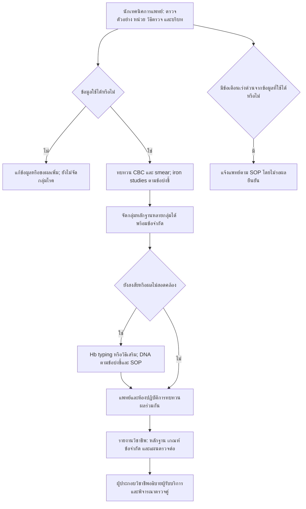

# ThalLink: quality remediation and implementation record

Date: 2026-10-15 (Asia/Bangkok). Scope: local learning and professional review,
using synthetic inputs. This is software work and a package for expert review;
no hematologist approval, institutional authorization, patient study, or UAT
participant results are asserted. Existing numerical cutoffs are unchanged.

## 1. Weakness register

Risk describes a plausible consequence of the software behavior, not a measured
clinical incident rate. Effort is estimated developer effort excluding clinical review.

| ID | Description / clinical risk | Severity | Effort | Fix / status |
|---|---|---|---|---|
| X01 | Screening and CBC accepted different demographic threshold contexts; wrong threshold could be selected | High | S, 0.5 day | Shared context normalization; contradictory/unsupported context rejected; unresolved context withholds dependent thresholds. Fixed |
| X02 | CBC demo origin lost on transfer; demonstration values could appear to be ordinary entered values | High | M, 1 day | Immutable source snapshot, demo notice, source report ID/time/hash and copied units in downstream reports. Fixed |
| W03 | Invalid CBC snapshot partly copied, overwriting destination before checking source | High | S, 0.5 day | Validate source status/types/units before mutation; on failure preserve destination draft/result. Fixed |
| W04 | Invalid screening result still exported false anemia/micro/hypochromia flags | High | S, 0.5 day | Invalid classifications now null/None; independent valid low-Hb alert remains. Fixed |
| W05 | Explicit alternate units could be silently discarded; CBC accepted NumPy boolean as number; missing optional DataFrame unit metadata could hide valid urgent Hb alerts | High | M, 1 day | Reject mismatches/boolean inputs; preserve declared units; treat scalar missing metadata as absent; retain independent valid urgency. Never auto-convert. Fixed |
| W06 | Changed/removed screening CSV retained old evaluated result with only generic caption | Medium | S, 0.5 day | SHA-256 comparison warns about changed input while keeping the intentional evaluated snapshot. Fixed |
| W07 | Single top pattern obscured overlapping findings and next-step ownership | Medium | M, 1–2 days | Additive multi-group evidence, uncertainty overlay, next actions/owners and clinician/patient draft wording. Implemented; clinical policy approval pending |
| W08 | No automated full-suite/coverage/inventory gate | Medium | M, 1 day | Pytest, correctness lint, >=80% combined statement/branch coverage, JUnit/HTML/XML/JSON, push/PR workflow and ruleset payload. Local verified; GitHub activation pending |
| W09 | Per-rule guideline mapping, local assay/population validation and expert approval incomplete | High | Expert-dependent | Generated rule inventory and expert review/UAT package prepared. Not resolved by software tests |
| W10 | Browser visual QA and human UAT not recorded | Medium | 1–2 days plus testers | Realistic scripts/acceptance criteria and blank results/sign-off prepared. Pending execution |
| W11 | Plausible bare value in wrong unit cannot be identified from value alone | High | SOP/integration-dependent | Canonical field names and explicit unit metadata supported; source interface must supply/check units. Residual limitation |
| W12 | ML prototypes and PCR panel remain demonstration assets | High if misrepresented | Validation-dependent | Existing demo labels/limits retained. No trained-model accuracy or kit approval claimed |

## 2. Cross-module issues: cause, patch, affected modules

### X01 — demographic context

Previously `_anemia_limit` returned the pregnancy cutoff before checking sex context,
while CBC rejected the same combination. The new common normalization distinguishes
missing context from unsupported explicit values. The male-reference/pregnancy
combination is rejected for review, without inferring a person's identity.

```diff
 def _anemia_limit(...):
-    if pregnant is True:
-        return adult["pregnant"]
+    sex_key = normalize_threshold_sex(sex)
+    # Unsupported/contradictory context cannot select a pregnancy threshold.
+    # Unknown sex+pregnancy withholds the dependent threshold.
```

This abbreviated diff explains the policy; executable implementation is in
`logic/validation.py`, `logic/engine.py`, and `logic/cbc.py`. The same screening
analyzer is used for single and batch rows. Age-only childhood behavior remains
available where it was already supported. UI labels explicitly refer to the sex
context used for a reference threshold.

### X02 — CBC provenance and transfer validation

Previously the callback set source=`blank`, cleared the destination, and copied
numeric fields without consulting source report metadata. It now validates first:

```python
# Executable implementation: ui/hematology_workbench.py::_copy_cbc_values
if result.validation_errors or result.support_code == "invalid":
    # Show a correction message and return before replacing destination state.
    return
# Check every transferred field against the canonical unit allowlist.
# Preserve source report_id, evaluated_at, input_origin, ruleset_version/hash,
# copied_values and copied_units as a deep-copied source_snapshot.
```

Affected files: `ui/hematology_workbench.py`, `utils/domain_reporting.py`, and
`tests/test_cross_module_provenance.py`. The old `input_origin` text is preserved;
the new `source_snapshot` is additive. Editing the destination does not mutate
the origin record; demo lineage remains visible after edits and navigation.

### Compatibility and units

- Existing valid-case scores, rule IDs, top patterns, and numeric cutoffs remain.
- Invalid screening classification flags now serialize to null instead of false;
  this intentional correction prevents consumers treating invalid data as normal.
- Screening ruleset version becomes `2026.10-review-4`; CBC becomes
  `cbc-adult-draft-2026.10.15-2` to identify the input-policy change.
- Screening JSON remains schema 2 with additive `clinical_grouping`; batch adds
  `clinical_group_labels` and serialized grouping. Old consumers should ignore
  new fields. Original fields are retained. Grouping has its own policy version/hash.
- Canonical names still define units for legacy callers. Optional API declaration:
  `units={"hb_g_dl": "g/dL", "mcv_fl": "fL"}`. CSV declarations use
  `hb_g_dl_unit`, `mcv_fl_unit`, etc. Wrong units invalidate that measurement;
  untrusted-unit Hb cannot trigger a numeric urgency conclusion. No unit conversion
  is inferred from plausible values. Blank or scalar-missing optional unit metadata
  uses the canonical field-name unit, including mixed-row DataFrames. Rejected
  string declarations remain in `declared_units` for review; their measurements
  remain invalid. Missing unit metadata is distinct from a missing measurement.
- The demo ML comparison and PCR panel remain experimental; this release does not
  train a model or certify a diagnostic kit.

## 3. Regression suite and traceability

```powershell
powershell -NoProfile -ExecutionPolicy Bypass -File scripts/setup.ps1 -Dev
powershell -NoProfile -ExecutionPolicy Bypass -File scripts/test.ps1
# Focused examples:
.venv/Scripts/python.exe -m pytest tests/test_validation_contracts.py tests/test_cross_module_provenance.py -q
.venv/Scripts/python.exe -m pytest tests/test_domain_boundaries.py tests/test_unit_contracts.py -q
```

All existing unittest tests are collected by pytest. New parametrized tests are
also included; `unittest discover` alone is no longer the complete suite.

| Requirement | Executable tests | Expected invariant |
|---|---|---|
| X01, W04 | `test_validation_contracts.py` | Demographic parity; invalid classifications null; valid urgency survives |
| X02, W03 | `test_cross_module_provenance.py` | Origin survives navigation/export; invalid source does not overwrite destination |
| W05, W11 | `test_unit_contracts.py`, `test_validation_contracts.py` | Wrong units rejected and traceable; CSV metadata retained; mixed-row missing metadata preserves valid urgent Hb; booleans/nonfinite/range violations rejected |
| W06 | `test_cross_module_provenance.py` | Changed/removed file warns; export remains original evaluated snapshot |
| W07 | `test_clinical_grouping.py` | All rule mappings; overlapping groups; missing/invalid never normal; urgency and old outputs retained |
| Screening/CBC cutoff boundaries | `test_validation_contracts.py` | Below/equal/above existing numeric cutoffs, age transitions and local reference limits |
| Six domains + PCR boundaries | `test_domain_boundaries.py` | 65 numeric fields, threshold branches, units, categorical gates and PCR tolerance/control combinations |
| W08 | `test_ci_contract.py` | Push/PR/merge_group, non-bypassed gates, missing reports not reported as pass |
| W09 inventory drift | `test_rule_inventory.py` | All modules/IDs/families represented; stale inventory fails |
| Existing safety behavior | All pre-existing tests | CBC, Hb peak handling, WBC totals, transfusion gates, reports, navigation and learning remain covered |

Example actual runnable pytest from the suite:

```python
@pytest.mark.parametrize("field,wrong", [("hb_g_dl", "g/L"), ("mcv_fl", "pL"), ("hct_percent", "fraction"), ("mch_pg", "ng")])
@pytest.mark.parametrize("analyzer", [analyze_screening, analyze_cbc])
def test_plausible_value_with_wrong_declared_unit_fails(field, wrong, analyzer):
    result = analyzer({**BASE, "units": {field: wrong}})
    assert result.validation_errors
    value = result.normalized[field]
    assert value is None or value != value
```

Imports and the synthetic `BASE` fixture are in `tests/test_unit_contracts.py`.
Boundary tests verify current implementation contracts, not clinical validity of
the chosen cutoffs. Subtests are reported separately from pytest test items.

## 4. Expert review and UAT package

Use `docs/RULE_INVENTORY.csv` together with `docs/EXPERT_REVIEW_UAT.md`.
The inventory contains rule IDs, conditions/operators, cutoffs, rationale/output,
source bibliography, code location, hash and explicit review status. A source link
at module level is not falsely represented as validation of every cutoff or score.

```powershell
.venv/Scripts/python.exe scripts/generate_rule_inventory.py --check
# Only after an intentional implementation/rule edit and before expert review:
.venv/Scripts/python.exe scripts/generate_rule_inventory.py
```

The expert package contains disputed-rule questions, synthetic clinical scenarios,
test-to-requirement mapping, expected behavior, actual-result/pass/fail fields and
separate technical, clinical and UAT signatures. Actual-result fields remain blank.

## 5. CI configuration

Complete workflow: `.github/workflows/quality.yml`. Complete optional default-branch
ruleset payload: `.github/required-checks.ruleset.json`. Activation and reproduction
instructions: `docs/CI_SETUP.md`.

The identical workflow has been installed at the current parent repository's
`.github/workflows/thal-labconsult-quality.yml`. The project-local copy supports
standalone distribution. GitHub remote, hosted run and merge-protection activation
remain pending; the local workflow does not claim to have changed repository settings.

## 6. Clinical grouping and workflow

Implemented as additive labels derived from existing rule IDs, with no new
diagnostic cutoffs. Full table, sources and discussion are in the expert package.

| Group | Existing evidence | Next professional action |
|---|---|---|
| Invalid | Any validation error | Correct data/units/context and reassess; preserve independent valid urgent alerts |
| Suspected alpha | `alpha_variant` | Review Hb/smear; consider HBA1/HBA2 testing within SOP |
| Suspected beta | `beta_trait` | Review separated HbA2, iron status/method; consider HBB/partner testing by indication |
| Suspected Hb E/variant | `hbe_pattern` | Confirm identity using suitable complementary method; molecular follow-up when indicated |
| Iron deficiency/mixed | `iron_deficiency` with or without other groups | Evaluate iron/inflammation; do not erase coexisting globin findings |
| Indeterminate | Unresolved/combined/atypical/pediatric rule, unknown rule, or missing context | Fill gaps and choose targeted follow-up; do not rule out |
| No specific pattern from supplied data | No matched rule plus conservative completeness checks | Review residual/family/partner risk; never report “not a carrier” |

The completeness checklist is a conservative display policy awaiting review,
not an instruction to order every listed test. A patient-facing explanation is
always a draft requiring professional review, not an automatic diagnostic report.



Workflow principles follow [ARUP Thalassemias](https://arupconsult.com/content/thalassemias)
and the source sections identified in the expert package; local sequencing,
turnaround times, responsibilities and assay availability still require SOP approval.

## 7. Implementation roadmap and open decisions

| Order | Work | Estimate | Status / owner |
|---|---|---|---|
| 1 | Correct validation and cross-module transfer; regression tests | 2–3 developer days | Implemented |
| 2 | Grouping, provenance and explicit unit contract | 1–2 developer days | Implemented; clinical policy draft |
| 3 | Full CI/coverage/inventory checks | 1 developer day | Local checks; hosted activation needs repository/branch |
| 4 | Expert review of every cutoff, age scope, assay and source mapping | 2–5 expert sessions | Pending hematologist/medical technologist and local SOP |
| 5 | Desktop/mobile/keyboard UAT with intended users | 1–2 days | Package ready; actual testing pending |
| 6 | Validate on independently adjudicated de-identified cases | Study-dependent | Protocol, ethics/data permissions and acceptance metrics to be defined locally |

Open decisions: selected Thai guideline/SOP version; screening MCH 26 vs local
screening convention; screening urgent Hb 7 vs CBC severe Hb 8 and their different
purposes; pediatric/pregnancy scope; assay-specific HbA2 and co-elution; iron and
inflammation handling; partner/reflex testing access; who authorizes patient-facing
reports; completeness policy and source metadata retention; GitHub repository and
protected branches. No numerical cutoff should change until the evidence and
expert disposition are recorded with new regression expectations.
