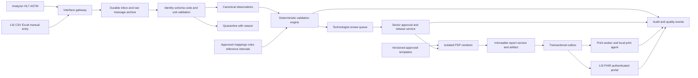

# ข้อกำหนดระบบออกแบบ ตรวจสอบ และพิมพ์รายงานโลหิตวิทยา

สถานะ: แบบออกแบบเพื่อทบทวนโดยห้องปฏิบัติการและทีม IT วันที่ 16 ตุลาคม 2026

อัปเดตการนำไปใช้จากรีวิวรอบถัดไป: preview และ HTML ดาวน์โหลดใช้เอกสารชุดเดียวกัน ตรวจ snapshot hash ก่อน render และใช้หัวรายงานที่บันทึกไว้; ผลตรวจสอบมี build/source/environment provenance; เพิ่มบันทึก/นำเข้าร่างงานสมมติ JSON พร้อมคำนวณใหม่ การทดสอบ Chromium/PDF สมมติอยู่ใน `scripts/browser_smoke.py` ดูผลจริงและขอบเขตใน [TEST_RESULTS.md](TEST_RESULTS.md) และ [REVIEW_FIXES.md](REVIEW_FIXES.md) งานเหล่านี้ไม่เปลี่ยนสถานะ clinical approval หรือทำให้เกิดบริการอนุมัติผล/PDF/เครื่องพิมพ์สำหรับงานจริง

ขอบเขตระบบเป้าหมายคือห้องปฏิบัติการในประเทศไทยที่ใช้เครื่องหลายผู้ผลิต เอกสารนี้กำหนดระบบใช้งานจริงและแยกจากต้นแบบข้อมูลสมมติใน `pages/10_Reporting.py` อย่างชัดเจน เกณฑ์ทางคลินิกทุกค่าต้องมีแหล่งที่มา รุ่น วันที่มีผล และผู้อนุมัติของหน่วยงาน

## 1. Executive Summary

- ใช้ Streamlit เป็นส่วนติดต่อผู้ใช้ และแยกบริการรับข้อมูล ตรวจสอบ ลงนาม สร้าง PDF และสั่งพิมพ์ออกจากหน้าเว็บ
- เก็บข้อมูลต้นฉบับและผลที่ปรับหน่วยแล้วแยกกัน พร้อมประวัติแหล่งที่มาและรุ่น mapping ที่ตรวจสอบย้อนกลับได้
- กลไกตรวจสอบเป็นกฎที่ทำซ้ำได้ ให้ผล PASS, HOLD หรือ REJECT พร้อมเหตุผลและหลักฐานของทุกกฎ
- PASS หมายถึงผ่านการตรวจตามนโยบายที่ระบุ ไม่ใช่การวินิจฉัยหรือสิทธิปล่อยผลโดยตัวมันเอง; การปล่อยผลต้องผ่านบริการสิทธิและนโยบายอนุมัติ
- รายงานแต่ละฉบับผูกกับ snapshot ของข้อมูล กฎ ช่วงอ้างอิง แม่แบบ และลายเซ็น การแก้ไขหลังปล่อยผลสร้าง revision ใหม่
- PDF ภาษาไทยต้องผ่านการตรวจฟอนต์ การตัดบรรทัด และการพิมพ์จริง; คิวพิมพ์ต้องแยกสถานะส่งงานจากการยืนยันว่ากระดาษออก
- รุ่นต้นแบบมีเฉพาะข้อมูลสมมติ การปรับแม่แบบ การตรวจเชิงเทคนิคบางส่วน และไฟล์ร่าง ไม่เชื่อมผู้ป่วยจริง ไม่ลงนาม และไม่ปล่อยผล

ISO 15189:2022 เป็นมาตรฐานคุณภาพและความสามารถของห้องปฏิบัติการ การออกแบบนี้มุ่งสนับสนุนระบบคุณภาพของหน่วยงาน ไม่ใช่การรับรองซอฟต์แวร์ ต้องทำตารางตรวจข้อกำหนดจากฉบับที่หน่วยงานมีสิทธิใช้งานก่อนเปิดบริการจริง [ISO 15189](https://www.iso.org/standard/15189)

## 2. System Architecture

### องค์ประกอบและการไหลของข้อมูล



**สมมติฐาน A1:** ติดตั้งภายในองค์กร แยก application, database, interface gateway และ print agent ตามสิทธิ; PostgreSQL เป็นฐานข้อมูลรายการจริง ส่วน Streamlit session state ใช้เฉพาะร่างในหน้าจอ ไม่เป็นแหล่งข้อมูลยืนยันการปล่อยผล

1. Gateway ตรวจผู้ส่ง ขนาด encoding และรูปแบบข้อความ บันทึกลง durable inbox ก่อน ACK ตาม interface agreement; รับข้อความสำเร็จไม่เท่ากับอนุมัติผลตรวจ
2. ตรวจ source/message-control-ID และ content hash: ข้อความซ้ำเหมือนเดิมไม่สร้างผลซ้ำ; ID เดิมแต่เนื้อหาต่างต้อง HOLD/quarantine และแจ้ง interface team
3. ผูก patient identifier พร้อม assigning authority, order และ specimen; ห้ามจับคู่จากชื่อหรือวันเกิดอย่างเดียว การ merge ผู้ป่วยต้องมี workflow แยก
4. ปรับเป็น canonical schema โดยเก็บ raw value/unit/code, numeric comparator เช่น `<`/`>`, absent reason, method, instrument และ mapping version; ห้ามเปลี่ยนผลที่เป็นข้อความเป็นเลขโดยเดา
5. ตรวจ panel completeness, QC/calibration, specimen, plausibility, reference interval, critical และ delta จาก snapshot เดียวกัน เก็บกฎที่ไม่สามารถประเมินได้ด้วย
6. ส่ง HOLD เข้าคิวตามความเร่งด่วนและเหตุผล ผู้ทบทวนเห็น raw/normalized/current/previous และที่มาของเกณฑ์ข้างกัน
7. สร้างและอนุมัติ revision แบบ optimistic concurrency; publish release event ผ่าน transactional outbox หลัง commit เท่านั้น
8. Worker ส่งผล พิมพ์ และติดตาม acknowledgement อย่างอิสระ การส่งล้มเหลวไม่ย้อนแก้รายงานที่ลงนามแล้ว

### ข้อตกลงการเชื่อมต่อ

| ช่องทาง | ข้อกำหนดที่ต้องตกลงก่อนพัฒนา adapter |
|---|---|
| HL7 v2 | รุ่นและ profile, ORU/ACK semantics, MSH sending application/facility/control ID/charset, PID authority, OBR order/specimen/time, OBX datatype/code/unit/status, NTE comments, escaped delimiters, correction/cancel workflow; เครือข่ายเครื่องมือต้องถูกแยกและมี gateway ที่ป้องกันข้อมูลระหว่างทาง |
| ASTM/vendor protocol | รุ่นเอกสารผู้ผลิตและตัวอย่างจริง, transport serial/TCP, frame/checksum, ENQ/ACK/NAK, timeout/retry, patient/order/result records; ห้ามสมมติว่าเครื่องทุกยี่ห้อที่ระบุ ASTM ใช้ profile เดียวกัน |
| CSV/Excel | versioned import template; allowlist columns, maximum file/row/cell limits, duplicate header/code detection; ปฏิเสธ macro-enabled workbooks และ formula cells ในช่องผลตรวจ; ไม่ execute สูตรหรือ external links; ข้อมูลผิดพลาดเข้ารายงานนำเข้าและไม่ถูกทิ้งเงียบ ๆ |
| Manual | เลือก order/specimen ที่มีอยู่ ตรวจหน่วยและ datatype แสดงที่มา manual และผู้บันทึก; กำหนด second check ตาม SOP ของรายการที่เกี่ยวข้อง |
| FHIR | **สมมติฐาน A2:** R4 4.0.1 กับ local profile ที่คู่เชื่อมต่อยอมรับ; DiagnosticReport อ้าง Observation แต่ละรายการผ่าน `result`, PDF ที่ออกจริงผ่าน `presentedForm`; ใช้ Patient, Specimen, ServiceRequest, Practitioner/Organization ประกอบ |

LOINC mapping ต้องตรวจ component, property, timing, specimen/system, scale และ method ไม่ใช้ชื่อย่อเพียงอย่างเดียว; ไม่มี mapping ที่ยืนยันแล้วให้ใช้ local code ที่มี namespace และ HOLD ตามนโยบาย ไม่สร้าง LOINC ขึ้นเอง UCUM ใช้เป็นรหัสหน่วยสำหรับเครื่อง ส่วนหน่วยแสดงผลอาจเป็นสัญลักษณ์อ่านง่าย ต้องมี conversion ที่ตรวจสอบมิติและ multiplier แล้วเท่านั้น ต้นแบบใช้รายการหน่วยที่อนุญาตแบบตรงตัว ยังไม่ใช่ UCUM parser ทั่วไป [LOINC](https://loinc.org/start), [UCUM](https://ucum.org/ucum), [FHIR DiagnosticReport R4](https://hl7.org/fhir/R4/diagnosticreport.html)

ASTM E1394-97 เป็นข้อกำหนด message content รุ่นเก่าที่ถูกถอนในปี 2002 และไม่ได้กำหนด low-level transport จึงต้องยึด interface specification ของเครื่องที่ใช้งานจริง ไม่เรียก E1394 ว่ามาตรฐานขนส่งข้อมูลปัจจุบันสำหรับเครื่องทุกชนิด [ASTM E1394-97](https://store.astm.org/e1394-97.html)

### บริการและ API ที่เสนอ

| API | เงื่อนไขสำคัญ |
|---|---|
| `POST /ingestions` | authenticated sender, idempotency key, raw hash; คืน receipt ID ไม่ใช่ release status |
| `POST /reports/{id}/validate` | immutable input revision + rule/mapping versions; คืน findings และ evaluation hash |
| `POST /templates/{id}/versions` | สร้าง draft ใหม่; ไม่มีการแก้ approved version |
| `POST /templates/{id}/versions/{v}/approve` | template approver คนละบทบาทจากผู้แก้ ตาม separation policy |
| `POST /reports/{id}/approve` | expected revision/If-Match, fresh authentication, explicit attestation, required reasons and credentials |
| `POST /reports/{id}/amendments` | original revision + reason + changed fields; ตรวจและลงนามใหม่ |
| `POST /report-versions/{id}/print-jobs` | released version, allowlisted printer, copy count, purpose, idempotency key |
| `GET /report-versions/{id}/artifact` | server-side patient/order authorization และ audit access |

ทุก mutation มี correlation ID; version ขัดกันคืน conflict และให้ผู้ใช้โหลดใหม่ ไม่ปล่อยให้ last write wins การแปลงข้อมูลและ validation เป็น pure functions ที่ไม่มี side effect; authorization อยู่ที่ API แม้หน้า UI จะซ่อนปุ่มแล้วก็ตาม

## 3. Data Model

ใช้ UUID สำหรับ internal keys, `numeric/Decimal` สำหรับผลเชิงปริมาณและค่าที่ใช้ตัดสิน, `timestamptz` สำหรับเวลา UTC และเก็บ source offset/precision แสดงเวลา Asia/Bangkok; ผลที่หายใช้ null พร้อมเหตุผล ห้ามแทนด้วยศูนย์ อายุต้องคำนวณ ณ เวลาเก็บสิ่งส่งตรวจและเก็บความละเอียดของวันเกิด

| Entity | ข้อมูลหลักและความสัมพันธ์ |
|---|---|
| Patient / PatientIdentifier | `patient_id`, identifier/authority/type, DOB/precision, demographic fields ที่จำเป็น; sex-related reference context แยกจาก gender identity; เก็บเท่าที่ใช้และมีสิทธิ |
| Encounter / Order | `order_id`, patient/encounter FK, requester, ward, urgency, requested panels, ordering time, cancellation status |
| Specimen | `specimen_id`, accession/barcode, order FK, type, anticoagulant, collected/received times, collector, integrity flags, acceptance decision/reason |
| Instrument / AnalyticalRun | instrument/method/site, software version, QC/calibration status, reagent lot, run time; เชื่อม observation กับ run ที่ใช้จริง |
| InboundMessage / ImportBatch | sender, control ID, raw artifact/hash, receive time, parse status, mapping version, errors, duplicate relation; unique `(sender, control_id)` ภายใต้ข้อกำหนด replay |
| TestDefinition / CodeMapping | local namespace/code, names TH/EN, LOINC/version/verification, specimen/method, canonical UCUM, precision, required-panel membership, mapping approver/effective dates |
| ObservationVersion | observation ID/revision, patient/order/specimen/test FKs, raw and canonical values/units, datatype/comparator, absent reason, instrument flags, measured/calculated provenance, observed time/status, predecessor |
| ReferenceIntervalVersion | test/method/site/specimen, age boundaries and inclusivity, sex/pregnancy context, unit, low/high or textual interval, source type/document/version, verification study, approver/effective period |
| RuleSetVersion / RuleDefinition | immutable version/hash, rule ID, applicability/dependencies, thresholds with units and comparator, missing-data behavior, action, source/review status, approved interval; numeric limits never hidden in templates |
| ValidationRun / Finding | input revision/hash, rules/mapping/RI hashes, engine version/time, decision; each finding has rule version, PASS/HOLD/REJECT/NOT_EVALUATED, measured evidence, threshold, scope and reason |
| Template / TemplateVersion | template ID/version, panels/language, layout JSON/schema, asset/font hashes, draft/review/approved/retired status, change reason, approver/date, effective interval |
| Report / ReportVersion | stable report ID, immutable revision, order/specimen, observation version references, template/rule versions, state, clinical snapshot hash, artifact hashes, predecessor/amendment reason |
| ReviewTask / Approval | assigned role/person, escalation, disposition/reason; signer identity/role, attestation, authentication evidence, approved revision/hash and timestamp |
| CriticalNotification | finding/report FK, verified value/unit, recipient and role, contact attempts/channel/time, read-back/acknowledgement, escalation, operator; cannot mark notified merely by creating an alert |
| Artifact / PrintJob / PrintAttempt | artifact kind/hash/location/retention; job original/reprint/amended-copy, source revision, printer/copies/purpose/idempotency key; each attempt spool ID/status/reason/time and confirmation source |
| Delivery / RecipientLedger | destination/profile, report revision, payload hash, attempts, received ACK, delivery status, superseded/retraction notification and acknowledgement |
| AuditEvent / OutboxEvent | actor/service, action, target revision, when, reason, before/after hashes, request ID/outcome; append-only permissions; outbox event ID/committed payload/retry/consumer receipt |

**Invariants:** approved snapshots never mutate; report observation references must belong to the intended patient/order/specimen; a release must reference a completed validation of that exact revision; no overlapping approved RI configurations for identical scope; no active template without the required report fields; unique print idempotency keys do not imply exactly-once physical printing.

Previous results are references to separately signed observations with their own timestamps and methods. Selecting a previous result requires patient identity, analyte, comparable units/method, specimen and time-window checks; transfusion/treatment or changed assay may invalidate comparison. Missing, censored, withdrawn, or noncomparable previous results remain explicitly unavailable.

## 4. Validation Rule Catalog

**Decision precedence:** REJECT > HOLD > PASS. REJECT quarantines unusable input or invalid binding; it does not delete evidence or automatically order specimen disposal. HOLD requests professional review. PASS requires every mandatory rule to be evaluated and passed or explicitly inapplicable under an approved policy. Missing configuration, service failure, unknown instrument flag, or ambiguous applicability cannot produce PASS. Urgent alerts from independent valid measurements remain visible even if another field is rejected.

| Rule ID | Description / logic | Severity | Action |
|---|---|---|---|
| IDENTITY_BINDING | Patient/authority/order/specimen identifiers resolve uniquely and consistently | Blocking | REJECT/quarantine incorrect linkage; correction workflow |
| SCHEMA_INVALID | Missing structural fields, wrong datatype, nonfinite numeric value, invalid timestamp or ambiguous decimal encoding | Blocking | REJECT affected payload; preserve raw |
| DUPLICATE_RESULT | Same message replay is idempotent; conflicting results for same specimen/test/run are not silently overwritten | Blocking | Ignore identical replay with audit; HOLD conflict |
| PANEL_INCOMPLETE | Required tests for the ordered panel absent/cancelled/unsuitable without permitted partial-report policy | Review | HOLD; distinguish not ordered from missing |
| UNIT_OR_MAPPING | Unknown code, mismatched dimension, unapproved conversion, missing unit where required | Blocking | REJECT affected observation; do not interpret its number |
| SPECIMEN_INTEGRITY | Clot, hemolysis, insufficient volume, wrong tube, stability breach; analyte/method-specific suitability rules | Review/Blocking | HOLD then accept/recollect/reject under SOP; never universal discard based on one generic flag |
| ANALYTICAL_READINESS | QC/calibration/run status absent, failed or expired; instrument not authorized for assay | Blocking | HOLD analytical release |
| REPORTABLE_RANGE | Value outside validated analytical/reportable limits or censoring requires dilution/confirmation | Review | HOLD; retain comparator, do not replace `<x` with `x` |
| INDEX_MCV | `Hct(%) × 10 / RBC(10^12/L)` versus reported MCV(fL), using configured rounding/tolerance and source method | Review | HOLD if discrepancy exceeds approved tolerance |
| INDEX_MCH | `Hb(g/dL) × 10 / RBC(10^12/L)` versus MCH(pg) | Review | HOLD under configured policy; undefined when denominator invalid |
| INDEX_MCHC | `Hb(g/dL) × 100 / Hct(%)` versus MCHC(g/dL) | Review | HOLD under configured policy; no auto-correction |
| RULE_OF_THREE | Optional `abs(Hct−3×Hb)` cue only when verified RBC/method conditions permit | Review | HOLD/review if applicable and above tolerance; otherwise NOT_EVALUATED with reason |
| DIFFERENTIAL_TOTAL | Complete mutually exclusive differential totals 100% within approved tolerance; partial differential treated as a lower bound | Review | HOLD contradictions; no forced rescaling to 100% |
| ABS_PERCENT_AGREEMENT | `WBC × fraction/100` versus measured absolute count; exact population definitions, correction status and units must match | Review | HOLD discrepancy; keep measured and calculated values separate |
| CELL_FLAGS | Blast/IG/NRBC, platelet clumps, abnormal scatter/histogram, WBC/platelet conflict mapped by analyzer model/version | Review | HOLD/manual smear review; unknown flag HOLD, never silently discard |
| REFERENCE_CONTEXT | Unique approved RI matches age at collection, reference sex/context, pregnancy if applicable, method/specimen/unit/site | Review | If unavailable, no normal classification; HOLD where interpretation required |
| ABNORMAL_FLAG | Compare using exact approved bounds/inclusivity before display rounding | Informational/Review | L/H; LL/HH reserved for approved critical limits; A for specified qualitative abnormality; absence of flag never means normal if RI missing |
| CRITICAL_VALUE | Approved critical limits/qualitative triggers and repeat policy, independent of ordinary RI | Urgent | HOLD/escalate, documented notification/read-back; release requires local critical-result workflow |
| DELTA_CHECK | Signed absolute and percent change, elapsed time; use approved abs/relative/RCV logic, thresholds, inclusivity and comparability policy | Review/Urgent | HOLD on configured failure; zero baseline makes relative change undefined; missing prior ≠ zero delta |
| THAL_PANEL_CONTEXT | Method-specific Hb fraction definitions, unresolved HbA2/E, total fractions and transfusion/age context | Review | HOLD incomplete/conflicting context; no genotype diagnosis from layout engine |
| COAG_RETIC_CONTEXT | Assay/tube/collection suitability; retic percent vs absolute populations; INR calculation requires valid method-specific ISI/control information | Review | HOLD missing requirements; no inferred INR or universal anticoagulant cutoff |
| POLICY_NOT_APPROVED | Required rule/template/mapping/RI not approved or outside effective dates | Blocking | HOLD; configuration editor cannot approve its own change |
| ANOMALY_REVIEW | Optional validated anomaly model; features, model version, confidence and influential observations visible | Review | Can add HOLD only; never remove a deterministic HOLD or claim confirmed mix-up/EDTA contamination |

CLSI H26 concerns automated hematology analyzer validation/verification and quality assurance; delta checks belong to EP33. EP28 covers reference-interval establishment/verification. AUTO15 provides a framework for autoverification algorithms and validation, including hematology/coagulation, not ready-made analyte cutoffs. GP47 addresses critical/significant-risk result communication. Sources for each configured threshold must be the applicable manufacturer document, verified local study, laboratory-approved guideline/SOP or approved critical-value agreement; do not copy example ranges from this prototype. [H26](https://clsi.org/shop/standards/h26/), [EP33](https://clsi.org/shop/standards/ep33/), [EP28](https://clsi.org/shop/standards/ep28/), [AUTO15](https://clsi.org/shop/standards/auto15/), [GP47](https://clsi.org/shop/standards/gp47/)

The index formulas above follow conventional units; recomputing an index derived by the analyzer from the same inputs verifies arithmetic/transcription, not independent analytical accuracy. Rule-of-three applicability depends on RBC and measurement conditions and is not a universal diagnostic check. [Beckman Coulter instrument manual](https://www.beckmancoulter.com/download/file/wsr-31842/177196BB?type=pdf), [Sysmex RBC counting paper](https://www.sysmex.com/training-and-knowledge/knowledge/hematology-white-paper---the-influence-of-rbc-counting)

### Corrected interpretation of the supplied synthetic example

| Check | Calculation | Defensible conclusion |
|---|---|---|
| MCV | `30.5×10/3.1 = 98.387… fL`, reported 98 | Difference about 0.387 fL; judge using approved precision/tolerance |
| MCH | `7.2×10/3.1 = 23.2258… pg`, reported 23.2 | Difference about 0.026 pg; not inherently inconsistent |
| MCHC | `7.2×100/30.5 = 23.6066… g/dL`, reported 23.6 | The requested example's MCHC mismatch is an arithmetic error; these values agree to one decimal |
| Rule of three | `3×7.2=21.6`, measured Hct 30.5; difference **8.9 percentage points** | Investigate applicability/interference/context; do not assert universal failure |
| Hb delta | `7.2−12.8=−5.6 g/dL`; `−5.6/12.8×100=−43.75%`, 7 days | Quantify change; DELTA_FAIL only when comparable and approved threshold/window met |

For the prototype the outcome is **HOLD**, because no clinical policy/RI/critical thresholds have been approved and release is disabled. A laboratory could additionally configure CONSISTENCY_FAIL or DELTA_FAIL under its validated policy; the software must not fabricate those findings from the scenario description. A mix-up or interference is a review hypothesis, not an established cause.

The catalog above specifies the production system. Implemented prototype reason codes are narrower:

| Prototype code family | Implemented behavior |
|---|---|
| `POLICY_NOT_APPROVED`, `CLINICAL_POLICY` | Permanent release block; RI, critical limits and analyzer-specific policy explicitly not evaluated |
| `ROW_SCHEMA`, `PANEL_SCHEMA`, `UNKNOWN_TEST`, `DUPLICATE_TEST`, `UNIT_MISMATCH`, `INVALID_VALUE` | Input-record quarantine for structural/type/unit problems; finite nonnegative values, actual fractions bounded at 100%; RDW-CV is not treated as a fraction |
| `REQUIRED_TESTS`, `TECHNICAL_INPUT` | Completeness and structural checks; a passing technical finding cannot remove the overall HOLD |
| `INDEX_MCV_FL`, `INDEX_MCH_PG`, `INDEX_MCHC_G_DL` | Recalculation and optional simulation tolerance comparisons |
| `DELTA_HB`, `DELTA_HB_ABS`, `DELTA_HB_PERCENT`, `RULE_OF_THREE` | Quantified change/context and optional configured comparisons; missing applicability/thresholds remain not evaluated |
| `DIFFERENTIAL_SUM`, `ABSOLUTE_*` | Five mutually exclusive synthetic differential populations and reticulocyte arithmetic; no IG/NRBC population inference |
| `SPECIMEN_REVIEW`, `SPECIMEN_FLAG_SCHEMA`, `CONFIG_INVALID` | Specimen review and invalid-input/configuration findings |

The prototype uses floating-point arithmetic with boundary-noise handling and tests; the production numeric/rounding policy must be separately validated. The current UI exposes simulation tolerances for RBC indices; other optional tolerance families are available in the pure engine API for tests and later UI work. This scope is intentionally distinct from implementing every production rule above.

### Proposed production engine pseudocode

```python
def evaluate(snapshot, policy, now):
    # Pure evaluation: no database write, signature, print, or patient matching here.
    findings = validate_schema_identity_and_units(snapshot)
    usable = independently_usable_observations(snapshot, findings)
    if not policy.is_approved_and_effective(now):
        findings.append(hold("POLICY_NOT_APPROVED"))
    for rule in policy.required_rules:
        scope = rule.applicability(snapshot)
        if scope.is_unknown or not rule.dependencies_available(usable, policy):
            findings.append(hold(rule.id, "NOT_EVALUATED", scope.reason))
        elif scope.is_applicable:
            findings.append(rule.evaluate(usable, policy))
        else:
            findings.append(not_applicable(rule.id, scope.reason))
    # Still evaluate independent valid urgent measurements after unrelated failures.
    alerts = critical_alerts(usable, policy)
    decision = aggregate(findings, precedence=("REJECT", "HOLD", "PASS"))
    return frozen_result(snapshot.hash, policy.hash, findings, alerts, decision)

# Separate authorized release service:
# verify rights + exact revision + approval/override policy + notifications
# prepare immutable artifact -> atomically record release, approval and outbox
```

An override does not change an original failed finding to PASS. It creates a signed disposition with reason, supporting evidence, role and scope; non-overridable failures such as wrong-patient linkage must be corrected upstream and revalidated. Any unexpected engine exception becomes a visible HOLD/system error, never a fallback PASS.

## 5. Report Template Specification

### Layout and fields

**สมมติฐาน A3:** A4 portrait is the default; prototype margin/font choices are layout preferences, not clinical limits. Production templates use a JSON schema and allowlisted components, not arbitrary Python, Jinja code, HTML or CSS supplied by end users.

| Block | Required content / behavior |
|---|---|
| Header | Institution/site/contact/accreditation text only if authorized; report ID and revision/status; patient identifiers with authority, name where permitted, DOB/age/reference context; specimen/accession/type; collection/receipt/report timestamps; requesting physician/ward |
| Result table | Local test code and TH/EN name, result/comparator/absent reason, unit, applicable RI plus source/version, H/L/HH/LL/A, previous result/unit/date and comparability indication; prevent hiding result/unit/flag or changing numerical formatting semantics |
| Morphology | Structured findings and reviewer-approved free text; indicate specimen and method; distinguish not examined from no abnormality observed |
| Interpretation | Versioned comment catalog plus attributable manual edits; no unreviewed AI text on released reports |
| Trend | Optional same-analyte, comparable method/unit observations in true time order; breaks for missing or noncomparable points, no interpolated missing result; mark transfusion/method change when known |
| Footer | Reviewer/releaser identity and authorization meaning, report time, page x/y, specimen/report identifiers, template/revision; approved limitations; controlled QR/barcode |
| Long report | Repeat compact patient/specimen/report header and table column headers on every page; keep result/unit/flag on one row; prevent detached signatures, clipped comments and orphaned section titles |

Six starting templates: CBC; CBC+differential; reticulocyte; coagulation; thalassemia screening; combined panels. Panels share the same Observation records and render configuration; a combined report must retain specimen-specific subsections/timestamps when tests use different tubes or collection times. ESR may be added as a method-specific optional panel after scope/RI verification; it is not silently included in CBC.

Example production template configuration (proposed schema, not the smaller prototype export schema). Null approval/font/rule references deliberately prevent activation:

```json
{
  "schema_version": 1,
  "template_id": "hematology-cbc",
  "version": "0.1.0",
  "status": "DRAFT",
  "panels": ["cbc"],
  "language": "bilingual",
  "page": {"size": "A4", "orientation": "portrait", "margin_mm": 15},
  "font_asset_version": null,
  "columns": ["test_name", "result", "unit", "reference_interval", "flag", "previous"],
  "mandatory_header": ["institution", "patient_identifier", "specimen_id", "collected_at", "received_at", "report_revision"],
  "sections": {"morphology": true, "interpretation": true, "trend": false},
  "reference_policy_version": null,
  "release_policy_version": null,
  "approval": null
}
```

The schema disallows unknown components, unbounded text/image sizes and invalid geometry, and requires a successful mandatory-field and pagination check before approval. Panel selection, row order and visible optional sections cannot remove required results or specimen attribution from a released report.

### Bilingual rendering and template governance

- Store translations as stable field IDs with TH/EN strings. Language selection changes labels, not values, codes, units, flags or clinical meaning; manually authored comments retain their original language and author. Do not automatically translate them on a released report.
- Store UTF-8; use a locally bundled, redistribution-permitted Thai font such as a verified Noto Sans Thai/Sarabun build, with file hashes and licenses. Pin font files, renderer and shaping libraries; no web-font fetch in the print worker.
- Use a Pango/HarfBuzz-capable renderer and embed fonts; inspect Thai upper/lower marks, mixed Thai/Latin, long names and line breaks in the actual PDF. PDF text extraction alone cannot verify glyph placement. WeasyPrint documents Pango/font embedding; deployed font files and renderer output still need acceptance testing. [WeasyPrint fonts](https://doc.courtbouillon.org/weasyprint/stable/api_reference.html#fonts)
- Numeric computation uses canonical units and full precision; round only for display using approved test precision. Dates retain timezone; Buddhist-year display, if selected by the laboratory, must be explicit and must not change canonical Gregorian timestamps.
- Template lifecycle: `DRAFT → IN_REVIEW → APPROVED → RETIRED`. Approval records layout hash, font/assets, required-field test results and approver. Editing an approved template creates a new version; old reports always resolve their original version.

Illustrative layout; brackets are placeholders, not invented reference intervals:

```text
[Institution TH / EN]           Report: [ID]  Revision: [n]
DRAFT / SYNTHETIC — NOT FOR CLINICAL USE   (prototype only)
Patient: SYNTHETIC-001    Female, 45 y    Specimen: DEMO-EDTA-001
Collected: [ISO date/time +07:00]  Received: [...]  Reported: [not released]
Requester / Ward: [synthetic placeholders]

Test / รายการ    Result    Unit      Reference interval    Flag   Previous
Hb                7.2     g/dL      [not configured]       —      12.8 [7 d]
Hct              30.5     %         [not configured]       —      —
RBC               3.1     10^12/L   [not configured]       —      —
MCV              98       fL        [not configured]       —      —
MCH              23.2     pg        [not configured]       —      —
MCHC             23.6     g/dL      [not configured]       —      —

Morphology: [not assessed]
Review note: MCHC recalculation agrees; delta policy is not configured.
Decision: HOLD — no release/signature in prototype
[Optional comparable trend]
Template [id/version]       [authorized signature in production]    Page x/y
```

### Implemented prototype boundary

`pages/10_Reporting.py` opens from **อื่นๆ → การออกแบบใบรายงานผล** after the AI placeholder. It is a utility page; the eight clinical-learning modules remain unchanged. The prototype uses fixed synthetic identifiers and editable example measurements, configurable presentation, deterministic checks, and draft exports. Reference intervals, critical thresholds and LOINC mappings are not fabricated. Tolerances entered for exploration are simulation settings and cannot authorize release.

The HTML draft can be opened locally and printed or saved as PDF by a browser. This is not a validated server-side PDF pipeline: pagination/fonts depend on that browser, and no print completion, authenticated report QR, electronic signature or immutable audit record is claimed. Production PDF, live imports, identity management, approved RI selection and queue services are specified here for later phases.

In this prototype, language selection covers report headings and test names; rule explanations remain Thai and are labelled accordingly. The optional comparison is a two-point table, not a validated longitudinal trend chart. SHA-256 identifies the exported snapshot but is not an electronic signature or an immutable audit trail.

## 6. Printing and Audit Workflow

### Review, approval and release

1. Create a draft bound to exact observation revisions; evaluate all applicable rules and queue HOLD findings with context and priority.
2. Technologist reviews measurements, specimen/QC, prior-result comparability and flags; records disposition and supporting evidence. Critical notification runs promptly according to the local SOP even while routine release is held.
3. Route specified categories to senior/pathologist sign-off. Required roles depend on assay/risk/SOP; a user cannot obtain clinical approval rights merely by being an IT administrator.
4. Freeze the candidate snapshot and required versions. Render in an isolated worker with resource limits and allowlisted local assets; fail on missing font, overflow or missing mandatory field.
5. Re-authenticate signer and show the exact revision and artifact. Bind explicit attestation to snapshot/hash and signing time. If any underlying revision changed, reject the approval as stale and repeat review.
6. Store the prepared immutable artifact, then commit release, approval metadata and outbox in a database transaction. Use staged artifact states and orphan cleanup because a blob store and database are not one atomic transaction. Consumers only process committed releases.
7. If embedding a cryptographic PDF signature, preserve content/unsigned-render hash and final signed-file hash separately; do not pretend the final file's hash can include its own signature/hash. Verification includes certificate/key status and signature policy.
8. Distribution/print workers operate on that frozen artifact. A formatting change after release requires an explicit policy: new clinical presentation revision when meaning/content can change, not silent re-rendering from current templates.

A typed name or signature image alone does not implement signer identity, intent and integrity. Use unique accounts, appropriate authentication, an attributable attestation and version-bound evidence; the organization must select an electronic-signature policy suitable for its legal context. [ETDA electronic-signature FAQ](https://www.etda.or.th/th/contact/faq/e-Signature.aspx)

### Print, reprint and amendment

| Step / state | Required behavior |
|---|---|
| QUEUED | Only authorized released revision, printer allowlist, location, copy count, purpose and request idempotency key; batch is a manifest of independent report jobs |
| SUBMITTED | Capture spool job ID and attempt ID; authenticated local agent; no arbitrary shell command or client-selected filesystem path |
| SPOOLER_COMPLETED | Record what the spooler actually knows; do not rename this patient/clinician delivery |
| DEVICE_CONFIRMED | Record device/agent evidence if supported; otherwise remain unconfirmed/unknown rather than claiming paper output |
| FAILED | Classify retryable/unrecoverable error; bounded backoff; alert queue operator and preserve each attempt |
| UNKNOWN | Query/reconcile existing spool job before retry; if outcome remains unknown require an authorized duplicate-risk decision |
| REPRINT | Retain canonical PDF bytes; generate a separately hashed print-copy artifact with REPRINT, source revision, request time and reason. Reprint changes print history, not clinical revision |
| AMENDED/CORRECTED | Create new report/affected Observation revisions with reason, before/after, predecessor and fresh approval; retain original; mark old version superseded in portal; notify every prior recipient and track acknowledgement |

IPP may report completion when the downstream device cannot provide final output status, so retry design must assume ambiguous outcomes. [IPP RFC 8011](https://www.rfc-editor.org/rfc/rfc8011.html#section-5.3.7.1)

FHIR R4 distinguishes report `corrected`, `appended` and `amended`; Observation R4 has amended/corrected but no appended status. Apply an explicit per-resource mapping and preserve resource version relationships rather than copying one report status to every Observation. [DiagnosticReport statuses](https://hl7.org/fhir/R4/codesystem-diagnostic-report-status.html), [Observation statuses](https://hl7.org/fhir/R4/codesystem-observation-status.html)

QR/barcode contains an opaque report reference, not names, HN or results. The destination authenticates and authorizes access on every request and shows revision/supersession status. A QR is not a permanent bearer credential. Secure portal delivery is preferred; any permitted email workflow uses verified destinations and organization-approved protection, with delivery/audit logging. The prototype has no network delivery.

### Audit, access control and quality indicators

Every edit, mapping/rule/template approval, override, access, download, print/reprint, release, amendment and failed authorization records who/what/when/why/outcome. Provenance records creation/transformation/signature lineage; AuditEvent records access/operational/security activity. Neither FHIR resource type itself makes storage immutable. Enforce append-only writer roles, separate administrators, retention-locked archives and independently stored integrity checkpoints; a hash chain editable by the same database administrator is insufficient. [FHIR Provenance](https://hl7.org/fhir/R4/provenance.html), [FHIR AuditEvent](https://hl7.org/fhir/R4/auditevent.html), [FHIR security](https://hl7.org/fhir/R4/security.html)

| Role | Allowed scope |
|---|---|
| Technologist | Enter/review assigned orders, resolve permitted holds, request print; no self-assigned release privilege |
| Senior/pathologist | Sign or override only within credentialed assay/site scope; reason mandatory; non-overridable failures remain blocked |
| Template/rule approver | Approve versioned content in authorized scope with separation from author as required |
| Lab manager | Aggregate quality metrics, staffing/escalation and policy review; individual records only with explicit care/quality authorization |
| Clinician | Read released reports for authorized patients/encounters, acknowledge critical/amended results |
| IT/service account | Operate infrastructure/interfaces with least privilege; no clinical sign-off by default |
| Auditor | Read relevant immutable records without editing clinical content |

PDPA design requires purpose/legal-basis records and DPO review for health/genetic data; consent is not assumed to be the only possible basis. Define retention/legal hold separately for raw messages, observations, signed artifacts, logs, backups and print spool. Retention locking must have a lawful duration, not indefinite storage. Encrypt databases/artifacts/backups at rest and connections in transit, manage keys separately, restrict decryption access, redact operational logs, and test restore and incident response. Apply applicable breach assessment/notification duties, including the statutory notification conditions and timing; a software checklist alone cannot establish compliance. [Official Thai PDPA, MDES](https://mdes.go.th/content/download-detail/4438)

| Indicator | Definition to version and stratify by site/panel/priority |
|---|---|
| Autoverification rate | Policy-autoverified releases / evaluated reports eligible under the same approved policy; also show eligible/all-received fraction, manual overrides, holds and rejects to prevent misleading rates |
| Turnaround time | Collection→receipt and receipt→first release separately; median/p90/p95, overdue counts, cancellations and incomplete reports accounted for explicitly |
| Critical notification time | Critical detection→documented recipient acknowledgement/read-back; unresolved cases shown as open overdue items, never omitted from denominator |
| Amended-report rate | Reports requiring a clinical amendment after release / released reports in a defined cohort and follow-up window; distinguish reprint and nonclinical formatting changes |
| Print quality | Failed/unknown/confirmed jobs, retry count, duplicate-risk decisions and reprint reasons; spooler success is not recipient receipt |

## 7. Implementation Plan

### Phases and exit criteria

| Phase | Deliverables | Gate to continue |
|---|---|---|
| 0 Scope and governance | Analyzer/profile inventory, intended use, data-flow/privacy review, clinical owners, RI/critical/delta sources, risk analysis | Laboratory and IT agree scope, interfaces and approval responsibilities |
| 1 Synthetic prototype — this delivery | Six panel layouts, TH/EN presentation, configurable draft, basic deterministic checks, escaped HTML/template/validation exports; no actual release | Automated functional/negative tests and reviewer acceptance of sample arithmetic; limitations visible |
| 2 Canonical ingestion | Typed schemas, identity mapping, CSV/Excel parser, one instrument/LIS adapter at a time, inbox/replay/quarantine | Vendor fixtures, malformed inputs, mapping/units and correction/replay tests pass |
| 3 Clinical policy and review | Versioned approved RI/critical/delta rules, QC/specimen gates, review queue, RBAC, override constraints | Independent historical-case validation and local policy sign-off |
| 4 Controlled reporting | Approved templates, packaged Thai fonts, PDF worker, signature/version binding, immutable artifacts/audit, amendment notification | Actual multi-page PDF/printed-page inspection, concurrency/tamper/recovery/security tests |
| 5 Printing and distribution | Local printer agent, batch manifests/retry reconciliation, authenticated portal/FHIR/LIS ACK ledger | Device-specific printer/UAT tests and end-to-end correction/notification tests |
| 6 Shadow operation then deployment | Observe against current LIS workflow, discrepancy adjudication, staff training, rollback/downtime SOP | Accountable laboratory approval; no automatic transition from prototype to autoverification |

### Python components and deployment

The current prototype retains the project's pinned Python/Streamlit/pandas stack without adding infrastructure dependencies. Proposed production components are FastAPI/Pydantic for API/schema, SQLAlchemy/Alembic with PostgreSQL, an explicit task worker/outbox (Celery/RQ are options after operational evaluation), constrained HL7 parsing with vendor adapters, openpyxl for screened `.xlsx`, and a pinned WeasyPrint/Pango/font environment for PDF. Use a validated UCUM/terminology service rather than ad hoc string substitution. OIDC from the hospital identity provider supplies authentication; API permissions still enforce laboratory roles. A Windows print agent or IPP/CUPS adapter must be verified against the actual printers. Final libraries, versions and licensing are a phase-0 decision, not installed by this prototype.

For production PDF use a controlled renderer host/container and explicit local fonts; Windows deployment requires native dependencies as well as Python packages. Restrict resource fetches, filesystem access, CPU/memory/time and output size. Untrusted HTML/CSS must not be passed directly to the renderer. [WeasyPrint installation and safety notes](https://doc.courtbouillon.org/weasyprint/stable/first_steps.html)

### Verification and clinical validation strategy

- **Unit/property tests:** formulas, unit conversions, inclusive/exclusive boundaries, rounding near cutoffs, zero/negative/nonfinite/boolean values, partial differentials, censored values, unknown flags, newborn/adult age boundary, missing sex/pregnancy context, mismatched prior units/method/patient and zero prior baseline.
- **Import contracts:** duplicate/conflicting messages, out-of-order revisions, encoding Thai text, delimiter/decimal ambiguity, formula-injection strings, workbook limits, rejected-unit provenance, partial batches and recovery after durable receipt but before ACK.
- **Workflow/security:** stale parallel approval, unauthorized patient/report access, template changes during sign-off, override reason/role enforcement, outbox crash/replay, wrong-patient QR, expired/revoked signer authorization, log tampering and backup restore verification.
- **PDF/print:** approved golden pages for every panel/language/font/long comment; compare actual rasterized pages and inspect Thai shaping, table continuation, page numbers, flags/units, QR readability and monochrome printing; retry after ambiguous spooler timeout, multi-printer batch isolation and reprint lineage.
- **Historical cases:** use lawfully available de-identified records with patient/time separation of development and validation sets; consecutive routine samples plus stratified rare/high-risk cases; include pediatric/pregnancy, transfusion, severe/censored results, specimen issues, flags and amended reports according to scope. Two qualified reviewers define expected decisions independently and adjudicate disagreement; do not treat the prior LIS decision as an infallible label.
- **Acceptance metrics:** prespecify sample selection, false-release definition, critical-result sensitivity, unnecessary-hold rate, subgroup results and confidence intervals with laboratory leadership. No universal numeric target or sample count is invented. Every observed unsafe-release discrepancy blocks deployment until investigated and corrected under change control.
- **Performance/continuity:** derive sustained/peak volumes, concurrent users, maximum batch/report size, recovery objectives and timeout limits from measured workload (**A4**, unconfirmed). Load test queues and rendering; downtime permits controlled manual work with later reconciliation and no uncontrolled duplicate release.
- **Optional ML:** only after a deterministic baseline is validated; version features/model/training cohort, exclude leakage, monitor drift and calibration, and give case-specific explanations. Model outage cannot convert HOLD to PASS; suspected mix-up/EDTA contamination requires relevant validated features and human investigation.

## 8. Risk Register

| Risk | Consequence | Mitigation / verification owner |
|---|---|---|
| Wrong patient/specimen binding | Result used for wrong person | Authority-aware identifiers, barcode/order checks, quarantine ambiguity, linkage UAT; laboratory + interface team |
| Wrong code/unit/multiplier | Incorrect clinical magnitude | Approved mapping/unit dimensions, preserve raw, boundary tests, two-person mapping review; method owner |
| Unverified RI/critical/delta threshold | False normal or missed urgent result | Scope-specific approved versions, no implicit defaults, missing-config HOLD; clinical lead |
| Applying rule of three universally | False failure or missed interference | Explicit applicability and method context, independent analytical checks; hematology lead |
| Stale report approved after edits | Signed content differs from reviewed content | Revision locking/hash binding and conflict test; backend team |
| Unacknowledged critical value | Delayed care | Read-back/recipient ledger, escalation/time monitoring and downtime procedure; duty technologist |
| Silent correction or lost recipient update | Clinician acts on superseded result | Immutable revisions, visible predecessor/supersession, recipient notification/ACK; LIS owner |
| Thai font or page clipping | Lost result/unit/flag or mistaken identity | Embedded verified fonts, golden PDF and actual printer tests; QA + laboratory |
| Duplicate/partial physical printing | Misdistribution, repeated action | Idempotent job creation, ambiguous-outcome reconciliation, copy watermarks and collection controls; print operator |
| PHI in logs/QR/temp/spool/email | Unauthorized disclosure | Data minimization, encryption, access checks, spool cleanup and DPO-approved retention; security/DPO |
| Audit altered by privileged account | Loss of attribution/evidence | Separate roles, append-only writes, external checkpoints and retention lock; security/auditor |
| Template/render injection | File/network access or resource exhaustion | Schema allowlist, HTML escaping, isolated worker and resource limits; application security |
| Outage or failed restore | Lost results or duplicate release | Durable inbox/outbox, monitored backups, restore drills and reconciliation; operations |
| Automation bias/ML drift | Unjustified release | Explanations, human accountability, shadow validation, no ML override of deterministic hold; clinical governance |
| False compliance claim | Unsafe rollout or legal exposure | Licensed-standard/SOP traceability, local acceptance and regulatory intended-use review; management |

## 9. Open Questions and Assumptions

| ID | Assumption / question | Owner and impact |
|---|---|---|
| A1 | On-premises deployment with a server-side authoritative database; exact OS/HA/backup topology not supplied | IT: determines hosting, authentication and recovery |
| A2 | FHIR R4 4.0.1 is a proposed integration baseline, not an assertion about the hospital LIS | LIS/vendor: confirm v2/FHIR profiles, ACK/status/correction semantics and test endpoints |
| A3 | A4 portrait, local Thai fonts and bilingual labels; approved paper design/margins/signature policy not supplied | Laboratory: approve fonts, layout, multi-specimen format and required fields |
| A4 | Medium-to-high volume is qualitative; daily/peak workload, concurrent users, printers and service-level objectives unknown | Lab manager/IT: measure before capacity planning |
| A5 | Analyzer models/software, QC feed and vendor flags unknown | Instrument owners: supply manuals, fixtures and verified assay definitions |
| A6 | No local reference intervals, critical limits, delta policies or index tolerances approved for this new reporting engine | Clinical lead: provide source type/document, verification evidence, applicability, comparator and review date |
| A7 | Prototype uses synthetic identifiers and examples only | Project owner: live patient data requires phase-0 privacy/security and clinical approval |
| A8 | All release decisions retain accountable human governance; whether a validated policy may authorize automated release is undecided | Laboratory director: define authorizing role, exclusions, overrides and periodic review |
| A9 | Retention periods, legal basis, data-controller/processor roles and cross-border restrictions are not supplied | DPO/legal: approve each data class, incident process and delivery channel |
| A10 | Printer model/driver, duplex behavior, output tray controls and feedback capabilities unknown | IT/lab: verify real device behavior before claiming completion |
| A11 | CAP participation/checklist edition and Thai medical-device software obligations depend on intended use and organization | Quality/regulatory lead: confirm applicability with current licensed material; no compliance claim from this design |
| A12 | Automated anomaly detection is optional and has no validated training data or performance claim | Clinical/data-science team: define labels, features, intended use and prospective validation before enabling |

The source pages above establish public scope and technical semantics. Clause-level ISO/CLSI/CAP compliance, institution-specific legal interpretation and approved clinical limits remain part of the laboratory's controlled review, not an inference from this architecture. Human expert validation and real-printer acceptance are separate gates from passing software tests.

CAP checklists are updated annually and tailored to the laboratory testing menu; the laboratory must identify its applicable licensed edition before mapping requirements. [CAP accreditation checklists](https://www.cap.org/laboratory-quality-solutions/accreditation/accreditation-checklists/)
